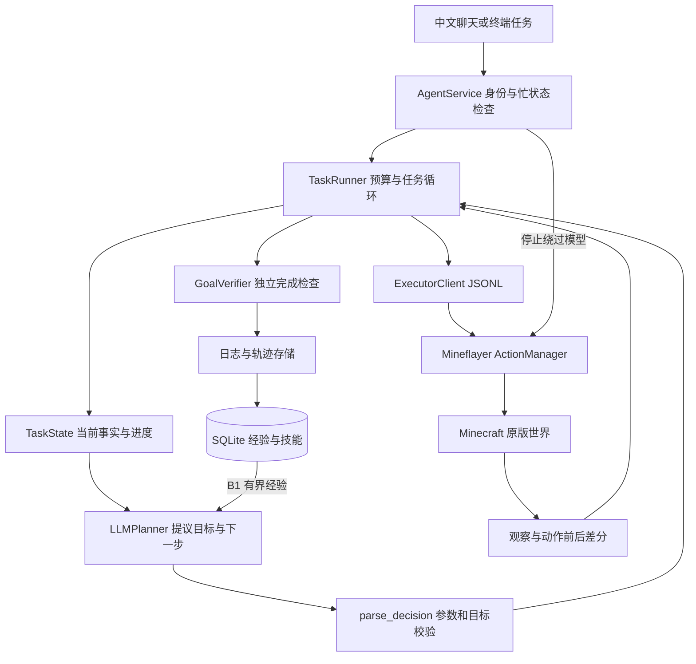

# 系统架构

第一阶段以原版可执行 Agent 为目标，遵循原始《Minecraft基础版Agent》中的高层决策、执行控制、观察验证和经验积累设计。原始方案保存在 `design/`，实现边界以本文和 VALIDATION.md 为准。

## 模块责任

| 原方案职责 | 实现位置 | 责任 |
| --- | --- | --- |
| TaskParser | `planning/planner.py`、`domain/validation.py` | 模型提出目标，程序校验 JSON |
| TaskState | `domain/state.py` | 初始库存、世界、观察、进度和用量 |
| Planner | `planning/` | 模型适配与单步规划 |
| PlanValidator | `domain/validation.py`、Node validation | 白名单、类型、范围、目标锁定 |
| FeedbackRouter | `execution/runner.py` | 继续、重规划、澄清或终止 |
| 执行控制 | `execution/`、Node ActionManager | 轮询、超时、单动作互斥、取消、部分结果 |
| 观察与验证 | Node observation、`domain/goals.py` | 状态观察和完成谓词复核 |
| SkillRetriever | `memory/retrieval.py` | B1 轨迹检索，技能自动调用待实现 |
| ExperienceWriter | `memory/store.py`、SQL migration | 轨迹、候选技能、复验、晋升和失效 |
| 评测 | `evaluation/`、`benchmarks/`、smoke 脚本 | 统计、实验约定与真实动作验收 |

首版把任务理解与下一步规划合并到一次模型调用，程序锁定解析后的谓词。完整 TaskSpec、多目标约束验证和对象消歧需要后续迭代，不能把提示词约束视为程序验证。

## 依赖方向

app 组装具体实现。execution 使用 Planner/Backend 协议和领域对象；模型与游戏客户端可以注入替换。domain 不启动模型、数据库或游戏。memory 保存结构化数据，不执行模板。evaluation 只读取结束记录，不根据聊天措辞判断成功。

Python 与 Node 分进程，使用 stdio JSONL。Node 端库输出统一送 stderr，避免污染协议。

## 一次任务

1. 检查指令拥有者与忙状态，建立唯一 task_id，保存初始库存与世界。
2. 模型建立一个可检查目标，提出一步查询或动作。
3. 校验器拒绝未知工具、无效参数和偷偷变更的目标；游戏侧检查材料、可达性、容器和配方。
4. Node 提交长动作后立即返回 action_id，Python 轮询状态，无需模型等待。
5. 保留前后快照、实际变化和错误，结合最新事实重规划。相同失败两次或预算耗尽时退出。
6. finish 触发新观察；容器目标还会重新检查容器。验证通过才进入 completed。
7. 结束后写 JSONL 和 SQLite。B0 不检索，B1 提供同世界、同规则版本、同目标类型和物品的最多三条历史证据。

取消通过异步事件和 cancellation token 阻断后续动作，迟到的规划响应不会执行。取消不回滚已有世界变化。当前不支持执行中直接重绑目标或重启后恢复任务。

## 完成条件与数量

支持背包至少 N、相对任务起点新增 N、到达坐标范围、容器至少 N、指定时长跟随成功。尚不支持同时验证多个目标、容器相对增量或全程资源保留约束。

原方案“指定来源减少2、指定目标新增8、角色无剩余”的完整复合条件仍是待办，不能把单个容器总量谓词当作完整数量守恒验收。搬运动作自身会检查来源与目标的数量变化。

## 经验与规则版本

当前事实使用前重新查询，长期轨迹同时保存成功和失败。参数化技能分 candidate / verified / invalidated，并关联规则依赖指纹。

晋升至少需要不同 scenario_id 和 task_id 的两次成功复验；记录明确声明 skill_id、场景及程序验证结果。真实重置由外部测试环境保证。模板生成、参数绑定、复演和自动调用尚未接入。

当前 ruleset_id 是人工维护标签，依赖比对与局部失效已有存储接口。后续从实际服务器读取规则、生成稳定指纹，再验证配置变化。

## 整合包扩展

新增后端先声明可观察的物品、配方、容器和动作能力，再映射统一操作和证据。高层不使用 Mineflayer 内部对象或某个模组机器名称。原版命名空间校验与 Node 离线认证限制当前有意保留，扩展时一起修改两侧协议和测试。

当前配方查询基于 Mineflayer 连接版本的内置注册表，不保证覆盖服务端自定义配方或模组机制。配方变化实验需要先完成服务器规则查询通道。
