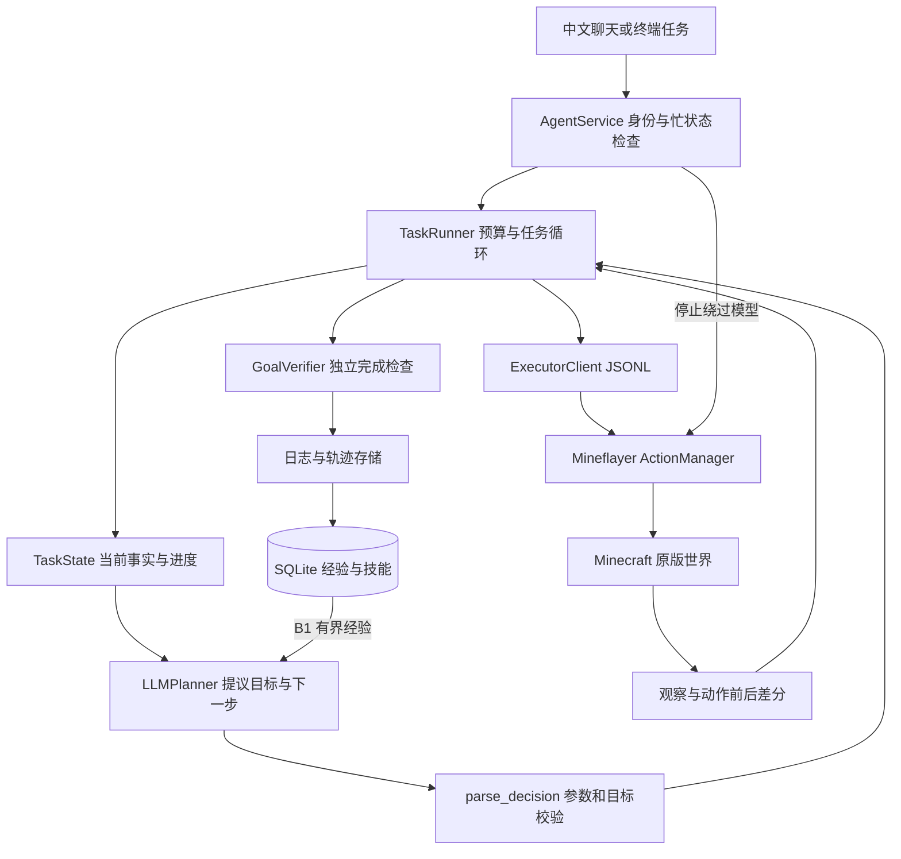

# 系统架构

## 两层原版路径（显式启用）

orchestration.mode=hierarchical（或CLI覆盖）使用agents/coordinator.py中的独立模型上下文；orchestration/task_runtime.py管理原始请求、Contract、阶段、重规划与版本；execution/controller.py为新旧路径共享动作实现；verification/service.py验收；interaction/delivery.py保存报告提交回执；persistence/task_store.py存当前任务。新路径仅B0，不检索跨任务经验。

任务约定可表达报告/解释，不强制首轮Goal。状态谓词只是验收手段，根基线不随阶段/纠正重置；报告依据、实际工作和提交回执均检查后才completed。重启识别中断，显式续接前核对；未知非幂等结果不重放。面板展示真实角色、阶段、预算与报告。

默认legacy保留，完整发布验收状态见[PROGRESS](implementation/PROGRESS.md)，运行与边界见[说明](implementation/RUNNING.md)。

## 既有 legacy 路径

第一阶段以原版可执行 Agent 为目标，遵循原始《Minecraft基础版Agent》中的高层决策、执行控制、观察验证和经验积累设计。原始方案保存在 `design/`，实现边界以本文和 VALIDATION.md 为准。

## 模块责任

| 原方案职责 | 实现位置 | 责任 |
| --- | --- | --- |
| TaskParser | `planning/planner.py`、`domain/validation.py` | 模型提出目标，程序校验 JSON |
| TaskState | `domain/state.py` | 初始库存、世界、观察、进度和用量 |
| Planner | `planning/` | 模型适配与单步规划 |
| PlanValidator | `domain/validation.py`、Node validation | 白名单、类型、范围、目标锁定 |
| FeedbackRouter | `execution/runner.py` | 继续、重规划、澄清或终止 |
| 执行控制 | `execution/`、Node ActionManager | 轮询、超时、单动作互斥、取消、部分结果 |
| 观察与验证 | Node observation、`domain/goals.py` | 状态观察和完成谓词复核 |
| SkillRetriever | `memory/retrieval.py` | B1 轨迹检索，技能自动调用待实现 |
| ExperienceWriter | `memory/store.py`、SQL migration | 轨迹、候选技能、复验、晋升和失效 |
| 评测 | `evaluation/`、`benchmarks/`、smoke 脚本 | 统计、实验约定与真实动作验收 |

模型模式把任务理解与下一步规划合并到一次调用，程序锁定校验后的谓词和约束。TaskSpec 包含 intent、goal、bindings、constraints、completion 和 task_version；绑定明确区分尚未观察的目标建议与有时间戳的容器事实。复杂指代仍可触发澄清，不能把模型猜测升级成世界事实。

## 依赖方向

app 组装具体实现。execution 使用 Planner/Backend 协议和领域对象；模型与游戏客户端可以注入替换。domain 不启动模型、数据库或游戏。memory 保存结构化数据，不执行模板。evaluation 只读取结束记录，不根据聊天措辞判断成功。

Python 与 Node 分进程，使用 stdio JSONL。Node 端库输出统一送 stderr，避免污染协议。

模型适配层将接口返回的 reasoning_content 与最终 content 分成 reasoning / decision 输出通道，通过可选观测回调传到 observability。每次调用以独立 call_id 归档到 model-calls/，增量日志保留进行中的文本，结束后原子写入完整快照。普通 trace.jsonl 只保存调用元数据及决策、执行和验证事件，避免大量输出片段挤掉任务时间线。

app/dashboard.py 提供本机只读 HTTP 面板，可按调用读取完整快照或尚在生成的增量日志；不接触模型密钥或游戏操作入口。思考不进入动作解析或任务长期经验。只有完整结束的最终输出才能交给原有决策校验器；截断、断流或取消均不执行部分决策，停止时先封存记录并丢弃迟到片段，见 DASHBOARD.md。

## 一次任务

1. 检查指令拥有者与忙状态，建立唯一 task_id，保存初始库存与世界。
2. 模型建立一个可检查目标，提出一步查询或动作。
3. 校验器拒绝未知工具、无效参数和偷偷变更的目标；游戏侧检查材料、可达性、容器和配方。
4. Node 提交长动作后立即返回 action_id，Python 轮询状态，无需模型等待。
5. 保留前后快照、实际变化和错误，结合最新事实重规划。相同失败两次或预算耗尽时退出。
6. finish 触发新观察；容器目标还会重新检查容器。验证通过才进入 completed。
7. 结束后写 JSONL 和 SQLite。B0 不检索，B1 提供同世界、同规则版本、同目标类型和物品的最多三条历史证据。

取消通过异步事件和 cancellation token 阻断后续动作，迟到的规划响应不会执行。中断后补采实际动作状态和背包，保留已经发生的副作用。显式“纠正”先取消旧任务，再递增 task_version，用新 task_id 保存续接记录，并将旧任务的观察和已完成步骤传给规划器。重启后自动恢复任务尚未实现。

## 完成条件与数量

支持背包至少 N、至少新增 N、精确库存增量、到达坐标范围、容器总量/精确增量、有限跟随，以及 all_of 复合条件。容器增量在第一次世界变更前建立独立基线，最终重新检查所有容器。

原方案“指定来源减少2、指定目标新增8、角色不残留本次材料和产物”使用 all_of 表达；已有背包库存和箱子库存不会被计作本次新增。搬运动作另行核对双方变化。

程序约束包括 no_move、no_collect、keep_inventory 和 allowed_sources。常见中文禁止/保留条款会直接抽取，模型可在首次决策补充结构化限制，之后不能放宽。合成前根据真实配方预估保留材料消耗，动作后再次核对库存。no_move 当前保守地仅允许不移动的只读查询，连可能寻路的容器检查也拒绝。

保留材料表达的是库存下限。首次目标若无依据地为该材料增加 inventory_delta=0，会在锁定前被拒绝并反馈重提；明确要求数量不变或交付数量守恒的目标仍允许。该有限语义检查不会改写目标，不是完整自然语言解析器。无绑定的“那个箱子/那些东西”也要先澄清，不能以模型猜测坐标触发基线检查。

## 规划器选择

默认 llm 使用兼容 Chat Completions 的客户端。rules 是无需密钥、可审查的有限中文语法基线，用于执行层验收和教学演示，不代表通用模型能力。真实验收分别标明规则规划、确定性动作和对抗性完成报告测试。

## 经验与规则版本

当前事实使用前重新查询，长期轨迹同时保存成功和失败。参数化技能分 candidate / verified / invalidated，并关联规则依赖指纹。

晋升至少需要不同 scenario_id 和 task_id 的两次成功复验；记录明确声明 skill_id、场景及程序验证结果。真实重置由外部测试环境保证。模板生成、参数绑定、复演和自动调用尚未接入。

当前 ruleset_id 是人工维护标签，依赖比对与局部失效已有存储接口。后续从实际服务器读取规则、生成稳定指纹，再验证配置变化。

## 整合包扩展

新增后端先声明可观察的物品、配方、容器和动作能力，再映射统一操作和证据。高层不使用 Mineflayer 内部对象或某个模组机器名称。原版命名空间校验与 Node 离线认证限制当前有意保留，扩展时一起修改两侧协议和测试。

当前配方查询基于 Mineflayer 连接版本的内置注册表，不保证覆盖服务端自定义配方或模组机制。配方变化实验需要先完成服务器规则查询通道。
