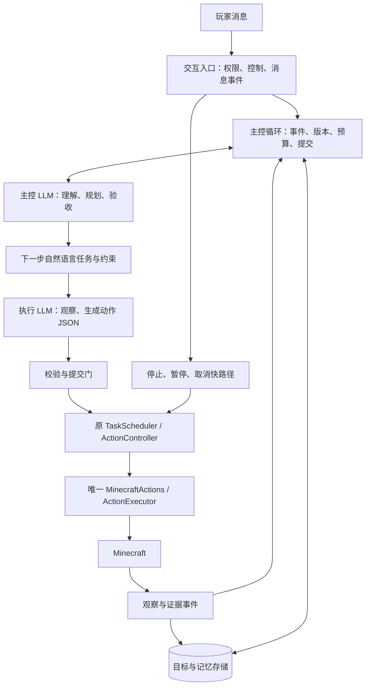

# 持续目标、自主决策与基本动作：Agent V2 设计

日期：2026-11-02。首版实验链路已实现，未实机验收；具体实现、275 项测试和缺口见 [V2 运行说明](agent-v2.md)。本文保留完整目标设计，不能将每项设计要求直接当作已实现行为。

用户要求：模型自行组合基本动作；有持续记忆并能推进完整任务的主控层；自然语言任务理解和验收；清理影响意图的默认参数；保持自主性，不把普通行动变成反复确认。本方案替代旧 P0–P4 计划中“保留组合技能为模型入口”和“总目标成功条件必须由代码枚举检查”的设计选择；底层可靠性和真实验证要求继续有效。

## 1. 要解决的结构问题

当前 `GoalManager.record` 把批次完成映射成目标完成，`InteractionService.finishDecisionTask` 随后禁止继续任务；`session.lastGoal` 又可能被技能名覆盖。模型能执行动作，但缺少对完整原话的持续负责机制。校验器保证结构合法，不能证明动作符合意图；`reply` 可以承诺行动却不产生任务。装备证据缺少统一汇总，掉落物缺少身份观察，也会妨碍模型判断。

V2 的核心对象是持续存在的玩家目标。动作批次只是推进目标的一次尝试。任何批次的成功、失败、取消或不确定，都不能直接代替总目标的语义判断。

不针对“木头”“胸甲”编写特殊路由；用目标完整性、基本观察、事件记忆、执行契约和语义验收共同覆盖制作、运输、探索、整理、建造等任务。能力仍受实际接口、感知范围和服务器支持限制。

## 2. 总体结构



主控与执行是两个职责、两个上下文；第一版可使用同一模型服务的独立调用，不要求引入第三个常驻模型，也不允许并发的世界写入。主控模型接收自然语言工作摘要和可追溯事实；执行模型接收有限工具目录、精确参数和短期引用。

“意识”的持续性来自程序循环与持久状态。LLM 每次只做一次决策；无需持续空转。没有活动目标时等待消息，有长时间加工时等待事件或带截止时间的观察，不按每个物理刻调用模型。

## 3. 职责与边界

| 层 | 决定什么 | 不承担什么 |
|---|---|---|
| 主控 LLM | 原话含义、任务分解、方法、可接受假设、下一步、自然语言验收 | 不编造世界事实，不直接调用 Bot |
| 执行 LLM | 查接口、观察具体目标、选择引用、生成短批次、解释阻碍 | 不改写总目标，不自行追加无关任务，不发布任务完成消息 |
| 主控程序 | 事件顺序、目标版本、预算、记忆提交、单写入权、恢复流程 | 不写死“见到木头就砍树”等策略，不用关键词替代完整语义 |
| 基本动作层 | 执行指定操作，复查对象，报告 API 与客户端事实 | 不自动选资源、不偷偷补材料或重试 |
| 证据与记忆层 | 保存来源、时间、范围、变化、失败和未知状态 | 不把模型总结升级成观测事实 |

主控可以自主选择材料、路线、配方、工具与中间步骤。寻路算法、窗口同步、按指定配方计算批次仍属于基本机制，可以保留；“自动找树、挖树、收集直到 N 个”属于任务策略，移交模型。

## 4. 持续目标与记忆契约

以下为设计接口草图，不是已实现 Schema。正文语义保持自然语言；固定字段用于调度、关联和持久化。

```ts
type GoalRecord = {
  id: string; owner: string; revision: number;
  originalRequest: string;           // 不可被技能名或批次名覆盖
  amendments: Array<{ messageId: string; text: string }>;
  objective: string;                 // 当前完整理解
  criteria: Array<{
    id: string; text: string;        // 自然语言成功要求/过程约束
    source: string[];                // 对应原话、补充或已声明假设
  }>;
  assumptions: Array<{ text: string; basis: string; reversible: boolean }>;
  progress: Array<{
    criterionId: string;
    verdict: 'met' | 'not_met' | 'unknown';
    evidenceIds: string[]; explanation: string;
  }>;
  remaining: string[];
  status: 'active' | 'waiting_world' | 'waiting_player' | 'paused'
    | 'reconciling' | 'completed' | 'failed' | 'cancelled';
  budget: { modelCallsRemaining: number; operationsRemaining: number;
    activeMsRemaining: number; absoluteDeadline: number };
};
```

目标生成时模型把原话展开为可检查的自然语言要求，不预置有限的任务判据库。复杂要求保留各个独立事项；简单单步目标可以只有一个。新观察允许补充中间里程碑，但不能为了宣布成功而删除要求、降低数量或改变“拾取”等方法限制。用户修订按版本保留来源；模型的理解调整也保留前后差异与解释。

记忆分三类：

1. 当前工作记忆：完整目标、约束、剩余事项、当前下一步、近期相关证据。每次调用都加载，优先级高于聊天历史。
2. 事件记忆：用户消息、目标修订、观察、批次提交、动作开始/结束、未知结果、模型判断、实际回复。不可用一段模型总结替换原始事件。
3. 可复用记忆：玩家明确偏好、经验证经验、历史位置线索。带来源和适用范围；旧坐标、旧库存只作重新观察的线索，不作为当前事实。临时指令不自动升级为永久偏好。

模型只提出记忆增量，由程序提交。系统摘要要区分“观测”“模型判断”“假设”；保留不确定性。上下文变长时按相关性取回证据，不能把未完成要求裁剪掉。重要要求过多时分页读取，不默默遗漏。

第一版持久层使用每 Bot 的单写入追加日志和版本化快照，接口为 `AgentStore`，以后可替换存储实现。发送游戏写请求前持久记录提交意图；写入失败时不发送新的世界操作，保留停止和只读查询能力。日志记录完整性、截断尾部恢复、快照版本迁移和会话锁须测试。诊断日志有截断与大小上限，不能拿它充当恢复账本。

## 5. 模型之间的协议

主控的自然语言内容使用一个薄的结构化外壳。机器只读 `kind`、版本、引用和预算，任务含义仍由模型理解。

```ts
type DirectorDecision =
  | { kind: 'advance'; goalId: string; revision: number;
      next: string; constraints: string[]; expectedEvidence: string[];
      memoryPatch: unknown }
  | { kind: 'assess'; goalId: string; revision: number;
      verdicts: Array<{ criterionId: string; verdict: 'met'|'not_met'|'unknown';
        evidenceIds: string[]; explanation: string }> }
  | { kind: 'wait'; goalId: string; revision: number;
      reason: string; wakeOn: string[]; deadline: number }
  | { kind: 'ask'; goalId: string; revision: number;
      question: string; whyObservationCannotResolve: string }
  | { kind: 'respond'; text: string }; // 说明性聊天，不结算、不执行

type ExecutorDecision =
  | { kind: 'query'; query: ModelQuery }
  | { kind: 'propose'; goalId: string; revision: number;
      purpose: string; operations: BasicOperation[];
      expectedEvidence: string[] }
  | { kind: 'cannot_execute'; missing: string; evidenceIds: string[] };
```

实际接口应对每个字段分别约束长度、枚举和类型，`memoryPatch: unknown` 仅为简化草图，实施必须定义可校验补丁。控制请求单独保留 pause/resume/cancel/replace，与聊天类型分开。新消息首先由主控判定是补充、纠正、查询、取消、替换还是新任务；只有明确控制指令走本地快路径。

执行模型可在单轮预算内自主查询接口与观察，普通查询不需要主控逐次批准。它生成批次后，主控进行一次内部语义复核：是否推进当前目标，是否遗漏或违反原话，是否有更小且可验证的一步。通过后由程序提交；不向玩家请求确认。初版每个写批次均复核，后续只有基于实测才能考虑合并调用，不能用执行模型自己的声明替代复核。

批次先沿用 1–4 个动作上限；新的对象引用依赖前一步世界变化时，结束批次、重新观察，不伪造未来引用。稳定且引用不被前序操作作废的多个动作可一起提交，避免一个转头也要一整套昂贵循环。结构或引用错误先反馈给执行模型修正，不把开发接口问题变成玩家澄清问题。

## 6. 主控循环与生命周期

1. 保存玩家消息，建立或修订完整目标；原话、修订和批次名称分开。
2. 读取最新事实与相关记忆，主控给出下一步自然语言任务。
3. 执行模型查询并提出短批次，主控内部复核，程序检查版本、权限、预算和引用。
4. 持久记录批次意图，在唯一执行链路中运行；每次新副作用前检查取消。
5. 收集所有动作的结果和相关新观察，不只保留最后一个动作。
6. 将批次结果作为事件交给主控。仍有要求未满足就继续；证据不足就观察；等待世界变化就订阅事件；只有不能自主解决的缺失信息才询问玩家。
7. 主控提出完成判断后，执行第 7 节的验收流程，成功才关闭目标。

`batch.completed` 只能触发“需要重新判断”，不能直接触发 `goal.completed`。失败可自主换方法；API 超时但可能已产生效果时必须先对账，再判断是否继续，不能重放消耗动作。

每 Bot 一个活动写目标。玩家聊天/问进度不取消目标；对当前目标的纠正增加 revision，使旧模型返回和未提交批次失效。明确替换先取消旧目标、等待旧原生操作释放控制权，再执行新目标。需要并列做的事情可以作为同一目标的多个事项，也可排入有来源的待办队列，但不能并发抢 Bot。

停止立即阻断未来提交并调用既有取消链路；旧 Promise 未结束前不释放租约。暂停保存进度，恢复先观察。完成后不自行建立新目标；闲置时不调用模型空转。

重启恢复先进入 `reconciling`：使全部短期引用失效，重读世界，对照最后提交/开始/结果事件。提交记录不等于操作发生，客户端状态也未必能证明因果；系统不承诺游戏操作 exactly-once。有明确结果的剩余任务可在原有授权、预算及期限内自动继续，不强迫玩家重述目标；已取消/暂停目标不自动恢复。无法判断是否重复交付、已经消耗或已在离线期间完成时，补充观察，仍不可区分才询问。

## 7. 自然语言验收与事实证据

目标验收由模型理解自然语言完成，不强制把每个玩家需求编译成 `inventory_at_least` 等有限谓词。现有 verify 查询和数值计算可以作为证据工具保留，不能成为唯一验收语言。

每条证据保存：id、goal/revision、批次/动作关联、来源、时间、游戏会话与维度、观测范围、请求/API状态、实际观察、未知字段。装备应分别报告手持和各护甲槽；背包变化保存基线与时段；掉落物保留可解码的身份及未知标记；过程约束还需要动作历史。背包增量不自动证明来源，交付出背包不自动证明玩家收到。

主控按每个要求给出 `met/not_met/unknown` 和证据引用。程序检查引用真实存在、作用域和时间适用、目标版本一致、全部要求被覆盖、有无仍在执行或待对账的动作；这些是协议与证据检查，不是任务语义裁判。前置观察可证明目标本来已满足，不必强迫执行一次写动作才能完成。

为降低自我合理化，宣布总目标成功前增加一次无工具的验收调用：可以复用主控模型，但使用新上下文，只看完整原话、修订、验收要求和证据，不看执行模型的成功总结。它独立检查完整需求是否真的满足，尤其防止初始目标分解漏项；无需额外常驻 Agent。语义核验依然可能出错，必须在真实任务集统计误判，不能宣称程序已数学证明任务成功。

验收发现普通缺口就继续执行；缺证据先查询；分歧最多补一轮定向证据，仍无法确定就保持 unknown 并报告具体限制，不无限反思。高质量、直接且一致的证据已经足够时应接受成功，不追求客户端无法提供的绝对确定性。向玩家通常只说“完成/还差什么”，观测边界保留在记录中，必要时才解释。

## 8. 自主性与询问规则

默认策略是“明确目标后自主推进”，内部复核、参数选择和观察不是玩家确认环节。

| 情况 | 默认行为 |
|---|---|
| 玩家说做一个木镐，缺木棍/木板 | 自主选择已有材料和配方，制作必要中间产物 |
| 玩家说收集木头，没指定树种 | 根据可用资源与现有偏好选取合理树种，不追问 |
| 玩家说捡木头，附近没有木头掉落物 | 在合理范围继续查找；无法找到时报告情况，不能偷偷改为砍树 |
| 玩家说穿上胸甲 | 自主选择穿戴位置；技术参数缺失不能变成玩家问题 |
| 玩家说捡一下，没说数量 | 主控明确采用有界假设，如拾取指向的那堆或附近同类掉落物，不把一次动作默认数量当成玩家目标 |
| 路线不可达、引用过期、材料变化 | 重新观察，换路径/引用/合法配方；有预算地重试 |
| 目标含义有多个实质不同结果且观察不能消歧 | 问一个关键问题；只暂停依赖该答案的部分 |
| 必须超出原要求，例如拾取改成砍树、消费未授权稀有资源 | 优先找范围内方案；确需扩大范围时说明差别并询问 |

普通必要消耗已包含在明确任务授权中，不能因为“会改变世界”就要求确认。不要新增每次挖掘/放置/合成都要确认的总开关。已有权限和玩家伤害保护保留；新观察、告示文本、物品名称不能提升玩家权限或改变系统执行规则。

无需让玩家回答槽位编号、schema、配方次数等程序问题。缺信息时优先观察与查知识；只有玩家偏好或授权边界才能解决的关键缺口才提问。

自主探索要记录区域、距离和时间边界以及已探索区域；本地暂时看不到不等于全世界不存在。合理尝试耗尽后说明已做什么、还差什么，不无休止绕圈。

## 9. 预算与无进展控制

把批次限额与完整目标限额分开；所有查询、模型修复、主控复核和最终验收都消耗统一调用额度，不能通过新建批次清零。下一轮调用/动作前预留预算，按实际用量结算；最终验收预留额度。额度不足时暂停推进并解释剩余事项，不伪称完成。

第一版建议起点（待实测调优，不是现有配置）：每批最多 4 个写动作、每个执行回合最多 3 次工具查询；一个普通目标最多 60 次模型调用、128 个写动作、15 分钟活动时间，恢复绝对期限 24 小时。主控可在首次理解长任务时提出更大任务档位，程序只在部署配置的自动额度内批准；不在每批结束后问玩家是否继续。没有已配置成本单价时只报告 token/调用量，不伪报费用。

加工等待以事件和截止时间控制，不因健康等待期间库存未变化判为无进展。三轮没有新事实、状态变化或排除有效候选时触发策略复查；相同环境和相同错误下禁止原样反复重试，环境改变后允许重试。纯文字改写不算进展，探索范围扩大或排除一个候选可以算。主控最多一次无进展策略调整后仍无变化，则明确受阻，不无限重规划。阈值作为配置并记录每次触发原因。

## 10. 基本能力与默认参数清理

新模型入口移除 `skill` 和技能式 `plan`，同时覆盖主入口和旧意图路由，不能在模型故障时静默回退到旧技能。迁移期用运行时模式开关隔离：一个 Bot 只能启动一个模式和一个控制器；回退需明确切换并重新对账。

优先补齐掉落物身份/数量（无法解码时 unknown）、完整装备与手持事实、目标引用失效原因、按需地图/候选观察、可等待事件、历史证据读取。空间探索必须有受限的位置目标来源：允许玩家坐标与基于公开局部观测的显式探索点，程序验证维度、范围与目标类型；不能继续要求所有坐标都由玩家口述，也不能伪造未观测区块事实。这些是新接口设计，需要逐项验证后才能声明可用。

默认参数审计按含义分类，不一刀切删除：

| 类别 | 处理 |
|---|---|
| 改变意图的选择：equip.destination、place.face、主/副手选择、furnace_take.minCount、目标总量/新增量模式 | 模型接口显式必填；普通判断由模型补全，缺字段先修正，不问玩家技术问题 |
| 精度/距离：navigate.range、follow.distance、look_at_entity.part | 新模型接口显式填写，防止用宽松默认距离替代真正接近；可从任务语境自主选择 |
| 工程限额：分页、查询半径、输出条数、协议超时 | 可保留并公开实际值与截断标记；限额不充当玩家成功标准 |
| 真正可选参数：不需要工作台的配方、铁砧第二物品等 | 保持可选，说明省略语义；不能把 optional 一律当作错误默认值 |

动作参数调整要同步原生/模型 schema、绑定、工具卡、生成的三个 JSON Schema、目录和测试。对外原生 API 如需暂留兼容默认值，应明确弃用期，不能让新模型入口继续依赖它。除默认值外还要统一观测 `chest/offhand` 与动作 `torso/off-hand` 的名称或提供单一映射来源，减少接口歧义。

## 11. 对现有代码的迁移映射

| 当前模块 | V2 处理 |
|---|---|
| `src/goals.ts` | 用持久 GoalRecord 和版本化生命周期替换；移除 completed 批次关闭总目标的逻辑 |
| `src/interaction.ts` | 保留聊天、权限、急停；把持续目标推进移到独立 AgentLoop，避免交互层继续膨胀 |
| `src/brain.ts` / `brain-decision.ts` | 拆主控、执行及提示词，保留模型调用适配；新模式不暴露 skill/plan |
| `src/brain-context.ts` / `brain-contract.ts` | 分角色上下文、自然语言目标、证据来源与版本契约 |
| `src/brain-feedback.ts` | 拆 BatchReport 与 GoalAssessment；取消用任意变化和最后一步决定整体 verified |
| `src/skills.ts` / `builtin-skills.ts` / `skill-runtime.ts` / 技能规划器 | 新模式不注册；新链路通过通用验收后删除生产依赖，历史测试素材改写为基本动作场景 |
| `src/scheduler.ts` / `controller.ts` | 保留短任务调度与租约；新任务只含基本动作，不作为总目标账本 |
| `src/actions.ts` / `executor.ts` / `control.ts` | 保留统一执行、取消、原生操作结束前占用控制权；补事实证据，不植入策略 |
| `src/observation.ts` / `targets.ts` / `operation-references.ts` | 补感知、命名统一、证据时间与引用生命周期；记忆引用不等于可执行引用 |
| `src/recipes.ts` / `requirements.ts` | 保留可选的只读计算服务；结果是规划依据，不自动执行 |
| `src/runtime.ts` / `examples/companion.ts` | 新装配模式，显式模型角色配置，仍共用一个执行器 |
| `src/diagnostics*` | 增加总目标/修订/批次/证据/评估关联和预算轨迹；区分内部复核与询问玩家 |

拟新增 `agent-loop.ts`、`agent-store.ts`、`director.ts`、`execution-brain.ts`、`evidence.ts`、`goal-assessment.ts` 和 `src/prompts/`。文件名可随实施调整，但职责不可再次混成“聊天回复即目标完成”。

## 12. 分阶段实施与退出条件

阶段 1–3 已有首版纵向切片，长期经验记忆等仍待补齐；阶段 4 未完成。按纵向切片推进，不先删除可运行系统再等待整个新系统完成。

1. **契约、证据与存储基础**：定义 Goal/Batch/Evidence、事件持久化、版本与预算；补装备/掉落物观察和参数审计。验收：任何批次完成都不修改总目标；崩溃窗口有待对账记录；单写入与取消回归不退化。
2. **双角色最小循环**：在新模式接主控→执行→复核→原执行器→事实→主控，停用技能入口。验收：一个包含移动、观察和物品处理的目标跨批次自主完成；玩家纠正能使旧提案失效；进度询问不丢目标。
3. **自然语言验收与自主恢复**：加入完整原话核验、记忆检索、等待事件、故障恢复和无进展策略。验收：未知结果先对账，重启不重复消耗，证据不足不虚报成功，必要中间操作无需确认。
4. **泛化与实际运行评估**：真实模型离线回放与真实服务器分别记录，完成下方矩阵；达到新链路标准后切默认模式、移除旧技能生产代码和旧路由。无法实测时维持未验收标记，不把模拟测试替代此阶段。

每阶段运行 `pnpm build` / `pnpm test`；Schema 变动运行 `pnpm schema` 并检查生成一致性。改写原来“批次完成后必须禁止下一步”的测试：应改为“总目标真正结束或取消后不能追加无关任务”，同时验证合法剩余任务可以继续。

## 13. 泛化验收矩阵

| 场景族 | 测试变化 | 判定重点 |
|---|---|---|
| 原话方法约束 | 捡/砍/找/拿着/穿上，多种物品与同义表达 | 方法不能偷换，不能只测试木头和胸甲 |
| 复合任务 | 过来再捡、制作后交付、拿取后穿戴、整理再返回 | 每个事项保留，跨批次不丢失 |
| 自主补前置 | 材料替代、缺中间产物、设施要先放置 | 不反复询问，选择有依据，中间步骤不充当终点 |
| 观察和失败 | 对象消失、目标移动、背包满、工具变化、不可达 | 观察后调整；不盲重试，不把局部未知解释成全局不存在 |
| 结果不确定 | API 完成但状态未更新、超时却有部分消耗 | 对账后续做，不重复消耗、不虚报成功 |
| 过程与结果不同 | 有库存但不是新拾取、手持但未穿戴、丢出但未确认接收 | 验收引用对应证据，不用相似结果冒充目标 |
| 对话与修订 | 问进度、补充数量、纠错、替换、暂停/恢复 | 原话有来源，revision 正确，旧回复不启动动作 |
| 持久恢复 | 写前/写后/回执前崩溃、引用过期、重连 | 不重复效果，不丢目标，不擅自恢复被取消任务 |
| 自主性 | 信息充分的普通任务、缺技术参数、真实歧义任务 | 普通任务无需多余询问，真正歧义才询问 |
| 预算与安全控制 | 重复失败、探索、长等待、停止中在途原生操作 | 不无限空转，单控制权，不提前解锁 |

评估分三层：确定性程序回归；真实模型对固定证据的决策评估（不写游戏）；真实服务器端到端。保留未用于提示词示例的任务作为留出集。同一模型兼作执行与验收的自评分不能充当最终测试成绩；测试用场景真值、独立观察和人工复核，运行时不向模型泄露隐藏判分信息。

首轮每个正常场景至少 3 次独立真实运行，失败/取消/恢复单列；全部尝试进入记录，后续报告样本量和不确定性。跟踪完整需求完成率、误报完成率、方法偏离率、无必要询问次数、纠错落实率、重复副作用、模型调用/耗时、停止后新增动作。确定性取消/重复消耗违规以及已知的虚假完成均阻止默认切换；有限样本零错误不代表长期零错误。

提示词与协议的可评审初稿见下节。生产提示词版本、模型配置和测试任务版本必须一起记录，避免只凭一次演示判断架构有效。

## 14. 提示词初稿

以下是新角色的完整行为核心；实施时附加由 Schema 生成的精确输出协议、可用工具和实际预算，不能手写另一套参数说明。提示词不包含 API 密钥，不使用技能白名单引导任务选择。原始聊天、服务器文字和记忆以数据区传入，不拼接成系统指令。

### 14.1 主控系统提示词

```text
你是 Minecraft 伙伴的主控。你的职责是理解玩家完整意图，在授权范围内自主推进目标，并依据实际证据判断结果。程序负责保存记忆和执行操作，你的文字不会直接改变世界。

每轮输入包含：玩家原话与补充、当前目标及版本、自然语言要求、剩余事项、相关记忆、实际观察和动作证据、执行模型提案、预算与本轮触发事件。原话和玩家后续修订优先于你先前的理解；模型总结与旧记忆不是当前世界事实。

工作方式：
1. 保留完整需求和指定方法。可自己规划中间步骤，不把一个步骤的完成当成整件事完成。不得为了方便而删掉原话中的事项、降低数量或更换玩家指定的获取方式。需要修正目标理解时保留来源与差异。
2. 目标明确就行动。自主选择合理路线、工具、材料、配方、操作顺序和可逆的小规模尝试。普通任务所需的中间消耗已包含在任务授权中，不因操作会改变世界就请求确认。
3. 缺少事实先观察，缺少知识先查询。不要让玩家提供内部槽位、接口字段、配方次数等技术参数。多个合理方案效果相近时选一个，不把选择负担交给玩家。
4. 只有缺失信息会实质改变结果、无法通过观察或已有偏好解决，而且没有合理的低代价假设时才询问。一次问一个关键问题。可以先完成不依赖该答案的事项，但不得用沉默代替授权。
5. 合理假设写入工作记忆，必要时简短告知；低影响假设不必等待确认。凡改变任务方法、使用明确保留的物资或扩张授权范围，先找范围内替代；确实需要扩大范围才询问。
6. 给执行模型一个足够具体的下一步：目的、不能改变的约束和需要返回的事实。允许其自主观察和选择具体对象，但它不能改写总目标。
7. 复核执行提案是否真正推进目标。错误槽位、遗漏事项、无依据对象和方法偏离应内部纠正，不转化成对玩家的技术提问。明确且有依据的提案及时提交，不为追求绝对确定性反复审议。
8. 操作失败不等于任务失败。区分路径、参数、材料、环境和未知结果，允许有依据地改进方法。可能已产生效果的请求先对账，不盲目重放。相同状态下反复失败要换方法；预算耗尽或无有效途径时如实报告剩余事项。
9. 根据证据逐项判断要求已满足、未满足或未知。接受足够的新鲜、直接且一致的证据；不要要求客户端无法提供的绝对证明。证据不足时做有针对性的观察，不捏造完成。
10. 总目标还有剩余且可行动时返回 advance，不只说“我现在去做”。respond 仅用于回答、解释或状态说明，不会启动动作，也不会结束目标。任务真正满足时返回 assess，由系统完成验收与结算。
11. 聊天和进度询问不丢弃目标。明确取消/暂停/替换优先处理；被取消任务不能自动恢复。已完成后不自行添加新目标。
12. 输出协议要求的对象，任务内容用简洁自然语言，只写决策、依据摘要和下一步，不输出长篇内心推演。玩家可见信息简短，避免每个动作都播报。

你的默认态度是主动、务实、能做就做。谨慎用于处理真实不确定和授权边界，不能成为不行动的理由。
```

### 14.2 执行系统提示词

```text
你负责把主控给出的下一步转成 Minecraft 基本查询和动作。输入中的完整目标、当前下一步、约束和版本是你的任务边界。你可以自主选择具体对象、参数与操作顺序，但不能改变目标或偷换方法。

1. 先利用已有且仍有效的事实，不为了形式重复查询。缺少对象、接口或状态时按需查询，返回的引用过期或环境变化后重新观察。
2. 使用提供的基本操作 Schema，显式填写影响结果的参数。不要生成 JavaScript、Python、Minecraft 命令或虚构技能。坐标、实体和物品引用必须符合实际接口的来源规则。
3. 选择参数是你的职责。能根据语境和工具说明解决的技术问题应自行解决；缺少决定方法的关键信息时返回 cannot_execute 给主控，不直接询问玩家。
4. 提出 1 到批次上限个有依据的动作。需要先前动作产生新对象或新观察时结束本批次，等待真实结果后再继续。禁止伪造未来引用；不同动作之间注意引用会因数量和位置变化失效。
5. 确认动作目的与主控任务一致。将物品拿在手上和穿在身上、挖掉方块和拾取产物、丢出物品和玩家收到，分别对待。此原则适用于所有物品与任务，不依赖特定案例。
6. 不在底层暗中重试、补资源或扩大任务。发现需要额外前置工作时把事实交给主控；属于当前下一步范围的观察、路线与参数选择可以自主完成。
7. 请求提交、API 完成、客户端观测和总目标完成是不同概念。准确报告能确认的事实与未知部分，不替主控宣告成功。
8. 操作结果可能不确定时优先提出对账查询，不能把超时视为从未发生。停止、暂停或目标版本失效后不提出新的写操作。
9. 返回协议要求的 query、propose 或 cannot_execute，不返回只有行动承诺的聊天文本。说“准备装备”不等于已提交装备。
```

### 14.3 最终验收提示词

```text
你负责判断玩家完整要求是否已满足。你只有只读证据，没有写工具。
输入：原始请求、玩家修订、当前自然语言要求、实际观察与动作记录、证据范围和未知状态。执行模型的自我评价不作为证据。

逐项对照原话与修订，先检查要求列表有没有遗漏或偷偷降低标准，再给出 met、not_met 或 unknown，引用相关证据并简短解释。
区分结果要求和过程约束；有了某物不一定证明按要求获得，某个 API 结束不一定证明效果。允许目标在行动前已满足，不强求必须产生变化。
接受足够直接、相关且时效合适的证据，不因为无法获得服务器绝对权威证明就拒绝一切完成。缺少证据时指出最小补充观察；确有未做事项时指出剩余事项。不要添加玩家没有要求的额外目标。
只返回评估对象，不向玩家请求确认，不输出动作，不靠一个总体置信分数代替逐项判断。
```

### 14.4 泛化行为示例

- “把这些铁锭存进去，再回来”：保存存入与返回两项要求；有明确箱子指向就直接执行，没有唯一对象先观察消歧，而不是每个箱子操作都询问。
- “做一把石镐”：自主查询配方、利用已有材料、获取必要前置和制作；如果合理方法不止一种，选择当前可行方案。缺材料不会自动成为“任务已失败”。
- “把帽子戴上”：自主理解穿戴位置；如果证据仅显示手持，就继续纠正，不先发成功回复再等玩家指出错误。
- “先走到桥边，看看能不能过去”：到桥边后仍需检查通过条件；不能因导航完成就关闭总目标。观察无法确认时表达未知，不声称已经过桥。
- “停”：立即走取消快路径，旧模型稍后说“继续”也不能产生动作；恢复必须有新的有效指令。

示例只是说明原则，不作为生产关键词规则。真实评估必须包含其他物品、顺序与措辞组合。

## 15. 设计自查与实际限制

- 自主性不能靠删除所有边界获得：范围内决策、内部错误修正默认自主；玩家控制权、真实对象引用和在途互斥保持硬约束。
- 多模型也可能共享误解：主控复核、基于原话的独立验收与留出集评测用于降低风险，不保证绝对正确。错误判定要保存证据供复核。
- 角色分离会增加模型调用和延迟：通过批次合并、相关证据检索和事件等待控制；先测正确性与询问率，再优化，不预先用未经验证的快速路径绕过语义检查。
- 去掉技能会失去某些已写好的应对细节：掉落延迟、树干候选、工具和背包限制等应转成基本观察与错误证据，以及可检索的经验说明；不能只删技能而不给模型必要感知，也不能把整套技能悄悄搬进新工具。
- 自然语言验收可以泛化，但证据层仍需编写代码：它应描述游戏机制和实际状态，不枚举所有玩家任务。尚无法观测的归属、因果或接收结果必须保留未知。
- 设计之后已接通首版实验链路、部分默认值清理与持久恢复，旧技能代码保留在 legacy。未完成真实模型/服务器验收，不能声称此前语义问题已在实机全部解决。
