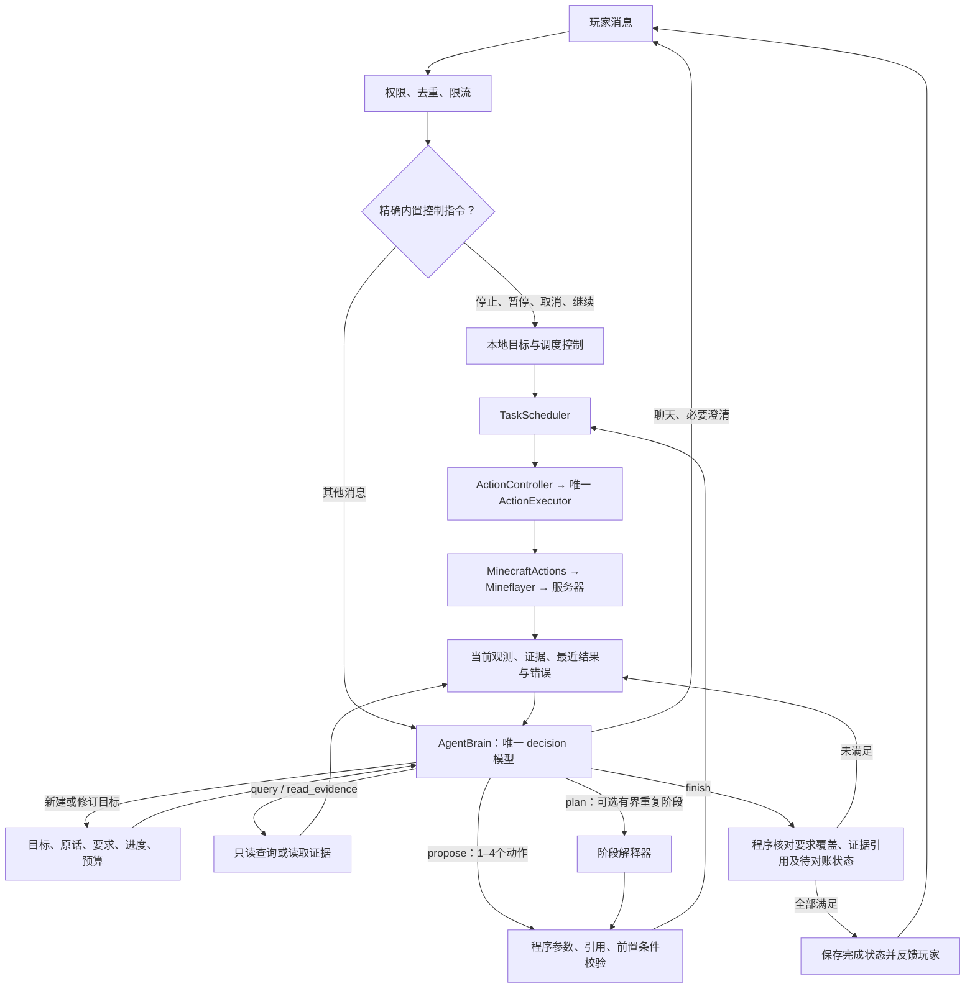

# 当前大脑架构

本轮验证：编译与全部 **334 项模拟测试通过**；动作/查询及阶段 JSON Schema、提示词审阅包已重新导出。未进行真实模型或服务器复测。

更新：2026-11-05，sim-v2-9。V2 使用一个决策模型，取消理解、主控、执行、独立验收之间的模型交接。世界查询和动作结果直接回到同一个决策循环。

## 实际路线

| 输入或事件 | 处理方式 |
|---|---|
| 精确停止/取消/暂停/继续 | 本地处理；继续后的目标推进可能调用模型 |
| 普通聊天、任务、修正、澄清回答 | decision，trigger=player_message；回复、澄清、控制或更新目标 |
| 有活动目标 | decision，trigger=goal_step；直接选择查询、短批次、可选阶段、等待、对账或完成 |
| 工具正常返回 | 自动进入下一轮同一模型，玩家不需要再次催促 |
| 动作或阶段失败 | 提供真实结果、具体错误和已发生效果，由同一模型修正 |
| 等待世界变化 | 有界定时或事件唤醒；暂停/等待玩家时不空转 |
| 重启后存在未确认动作 | 先观察、引用证据 reconcile，再允许新写操作；不能直接重放 |

聊天通常一次调用。执行任务通常是建立目标一次、每次查询/批次决策一次、完成判断一次；中间需要多少轮取决于任务。可选阶段内部正常节点之间没有模型调用。完成判断仍使用同一 decision 角色，没有另一个 assessor 请求。

唯一模型优先使用 agent.model，兼容旧 agent.director，再沿用运行时 LLM_PLANNER_MODEL 配置；默认服务加载仍优先 DeepSeek。V2 不使用前置小模型、LLM_FAST_MODEL 或单独 agent.executor。显式 legacy 保留原链路与提示词体系，不属于本版单模型实现。

## 模块职责

| 模块 | 负责内容 |
|---|---|
| agent-brain.ts / agent-prompts.ts | 唯一模型的提示词与 Schema、上下文打包、解析、超时和取消；不操作 Bot |
| agent-loop.ts | 目标修订、持续循环、工具结果回传、预算、提交、持久化和恢复对账 |
| agent-contract.ts | 结构化决定、目标和证据契约；保留旧导出供兼容，运行注册表只使用 agentDecisionSchema |
| tool-contracts.ts | 查询输入含义与输出路径，作为模型接口契约随提示词审阅 |
| observation.ts / targets.ts | 当前世界观察和统一短期引用，不负责选任务或自动重试 |
| agent-context.ts / agent-store.ts | 有限工作上下文、完整持久事件和按需证据读取 |
| stage-plan.ts | 可选有界阶段图、参数绑定、循环和中断；失败返回决策循环 |
| agent-preflight.ts / operation-gateway.ts | 参数、有效引用、版本能力与执行前提等程序校验 |
| scheduler.ts / controller.ts / executor.ts | 排队、取消、原生动作互斥和唯一写入控制权 |
| resource-memory.ts | 历史容器线索；重新观察后才能作为当前事实使用 |

## 对象与查询契约

- snapshot.entities、observe_targets.targets、find_blocks.blocks 和范围内已加载的 inspect_block 共用 ref。模型操作使用 ref；原生接口保留数字 id/坐标。
- observe_targets 的 names 是兼容的方块过滤器，与 blockNames 合并。entityNames 过滤实体/玩家名，itemNames 过滤掉落物内容，entityKinds 区分 player/item/mob/other；实体过滤字段自动启用实体观测，多个实体过滤条件取交集。
- 例如拾取原木和铁锭：`{"type":"observe_targets","itemNames":["spruce_log","iron_ingot"],"radius":16,"limit":16}`。物品身份未知时不会误匹配名称，可用 entityKinds:["item"] 查看全部掉落物。
- 引用默认有效 30 秒、注册表上限 256；重复观察同一未变化目标会复用有效引用但不延长寿命。实体消失、身份变化、方块状态变化、维度变化等仍会使操作失败，下一轮需重新观察。
- 实体快照最多最近 64 个，entitiesTruncated 明确表示截断；空列表不证明整个世界没有目标。
- lastTool 保留最近工具结果，lastFailure 提供错误，freshEvidenceId 指向当前观察。阶段绑定失败报告缺失路径和可用键，不能继续猜测 logsTotal 等不存在的输出。

走近不证明拾取，挖掉不证明获得。决策模型应结合新的背包/实体观察判断，并以实际证据解释完成。程序能够检查证据引用存在、来自本目标、要求完整覆盖和没有待确认动作；它不能独立证明所有自然语言要求的语义正确性。

## 提示词与启用

[完整提示词审阅包](brain-prompts-review.md) 由 pnpm prompts:export 从实际注册表导出，包括唯一 system 消息、完整输出 Schema、查询契约与动态输入字段。导出不会读取密钥或调用模型。

本次修改正文、角色、Schema 与输入契约，旧 sim-v2-8 授权不匹配新版。按用户“所有提示词都先给我看过”的要求，先展示新审阅包，再更新本机授权。显式 SIM_APPROVED_PROMPTS 优先于项目本地 .prompt-approval.local.json，后者被 Git 忽略。生产 V2 在授权不匹配时不发请求，仍保留本地停止/暂停。

默认 pnpm companion、启动AI伙伴.cmd、启动AI伙伴V2.cmd 都使用 V2；旧进程不会热更新。本轮不重启现有伙伴，不修改运行中的目标记录。

## 验证边界

新增模拟回归使用真实观测、目标注册表、操作绑定与调度代码：查询两个不同掉落物，连续导航，核对背包增长和实体消失；错误过滤反馈后由脚本模型更正；可选阶段遍历两个目标。另检查引用复用/过期、旧实体身份拒绝、实体截断和方块可执行引用。既有取消、额度、任务修订、恢复对账与存储失败回归继续保留。

测试模型与 Minecraft 物理行为为模拟。本轮没有调用真实 DeepSeek、连接服务器或验证实机砍树/拾取成功率。单模型减少调用与转述，但不能保证它永远选择正确参数；仍需实机复测。多目标并行、通用长期偏好和经验学习未在本轮实现。
