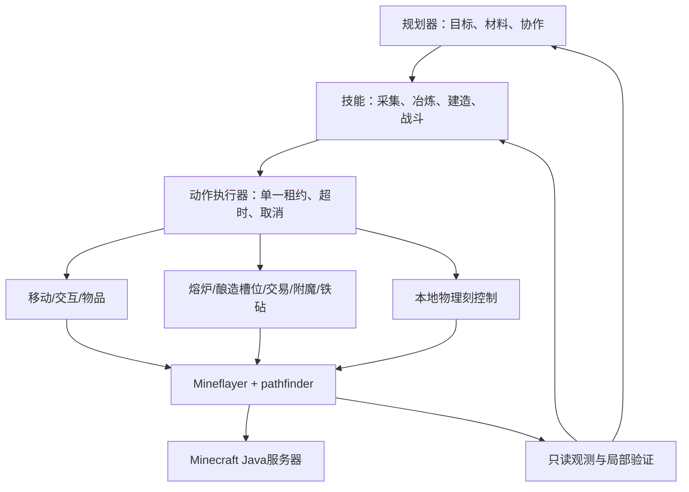

# SIM底层动作设计与CoCraftBench分析

## 结论与来源

是参考Mineflayer，而且执行时真正调用Mineflayer。SIM没有重写Minecraft协议，也没有用文字模拟动作结果。Mineflayer负责连接、客户端状态和游戏操作；pathfinder负责寻路；SIM负责参数校验、目标检查、执行租约、取消、等待、错误归一化和局部验证。

本轮在原有19种动作上新增24种，形成 **43种动作 + 5种只读查询**。这不是“完整实现CoCraftBench的42个工具”，因为它们处在不同抽象层：一个benchmark工具通常需要多个SIM动作以及一个上层控制器。

阅读依据：

- [CoCraftBench README](https://github.com/Serein55/CoCraftBench/blob/be208787b6d1831c8897e42a505319c04db5923b/README.md)：100题、42个契约，仍处于设计规范阶段；没有世界包、运行器、grader或实机成功率。
- [42个工具及原生映射](https://github.com/Serein55/CoCraftBench/blob/be208787b6d1831c8897e42a505319c04db5923b/docs/action-map.md)。
- [接口规范与证据边界](https://github.com/Serein55/CoCraftBench/blob/be208787b6d1831c8897e42a505319c04db5923b/benchmark-design/v0.3/Mineflayer%E6%8E%A5%E5%8F%A3%E8%A7%84%E8%8C%83.md)。
- [Mineflayer官方API](https://github.com/PrismarineJS/mineflayer/blob/master/docs/api.md)，以及本项目安装目录中的4.39.0源码。
- 本地参考仓库固定提交：`be208787b6d1831c8897e42a505319c04db5923b`。

CoCraftBench核对的是Mineflayer4.33.0及部分本地补丁，目标Minecraft Java1.21.6；SIM继续使用已有4.39.0，没有假定二者行为完全等价。本轮重新检查了安装版本的公开类型和插件实现。目标版本的数据注册表存在，仅说明可解析数据，不证明游戏机制已实测。

## 把“底层”分清楚

|层|例子|谁实现|结果含义|
|---|---|---|---|
|原生输入与交互|setControlState、attack、activateItem、dig|Mineflayer|输入已发出或原生Promise结束|
|SIM动作与局部控制|move_ticks、furnace_take、trade、enchant|本项目|完成明确的局部后置条件，附客户端证据|
|组合技能|采集16个原木、熔炼16铁锭、举盾面对威胁、按蓝图建墙|后续技能层；smelt.ts有组合示例|需要多步执行、失败恢复与任务相关验证|
|规划与协作|材料依赖、分工、改需求、断点恢复|伙伴大脑/任务调度器|目标推进与玩家协作|
|独立判分|来源、命中、精确格挡、整题通过|服务器grader|权威E2证据，不能作为Agent额外感官|

例如`dig`不自动寻找树、不自动装备斧头、不保证捡到原木；`trade`也不自动寻找有指定书的村民。将这些职责分开，才能在画布中将小动作合并为可展开的“采集”“交易”“建造”技能。



## CoCraftBench真正需要什么

源目录将42个工具分为11个native_wrapper、2个plugin_wrapper、14个controller_required、9个experimental_controller、3个planner_service、1个presentation_service和2个orchestrator_service。它自己也明确写着spec_only。我们采用它的需求分析，不把拟议工具名当成Mineflayer现成方法。

|任务群及例子|需要的基础能力|SIM本轮实现|仍需上层补齐|
|---|---|---|---|
|MC-01–14资源、工具、铁锭、剑盾|观察、寻路、挖掘、装备、合成、熔炉|原有动作，加find_blocks/recipes/craft_output/furnace_*|许可区域、工具选择、掉落拾取与来源账本|
|MC-15–28剪羊毛、桶、种植、繁殖|主手物品使用、方块/实体定点交互、条件检查|activate_entity_at、块属性查询、wait_until|年龄/成熟度解码、收获复种、产物统计|
|MC-29–50房屋、下界、药水、附魔、恢复计划|精确放置、GUI、维度观测、持久状态|furnace_*、brewing_*、enchant、anvil、dimension条件|蓝图朝向与双格、酿造状态机、传送门路线、计划持久化|
|MC-51–60工作站与村民|正确区分制箭台职业与工作台合成，动态报价、铁砧|trade_inspect/trade、anvil、craft_output|职业锁定判定及砂轮/制图/切石/锻造/合成器GUI|
|MC-61–70战斗、水下与船|按物理刻持用、转向、近战、氧气与乘坐关系|move_ticks/use_item_ticks/wait_ticks、氧气观测、mount/vehicle_control|弩装填、弹道/提前量、冷却/暴击、落地水、驾驶路线|
|MC-71–80红石、考古、环境|properties读回、输入、等待自然变化|inspect_block/verify/wait_until|电路设计、朝向策略、考古刷扫协议、声学/环境判定|
|MC-81–100试炼、恶魂、拴绳、钓鱼等|交互、效果/组件、物理控制、钓鱼|fish_once、原始组件与实体元数据、交互积木|快乐恶魂驾驶/吊运、拴绳图、宝库资格、弹射物反击与来源链|

逐题分析不是按几个示例推断：脚本读取原始`task-interface-map.json`的全部100个action_ids，生成[逐题对照表](cocraftbench-tasks.md)和[机器可读覆盖表](cocraftbench-coverage.json)。后者保留42个工具的映射、剩余工作、源提交、100题的动作集合，所有实机状态为not_run。

## 新实现中的关键设计

### 观测先于操作

snapshot输出sessionId、clientTick、位置/速度、血量/饥饿/氧气/经验、装备、背包指纹和附近实体。读取范围最大32格，默认快照16格；方块只读已加载数据。没有服务器完整世界、隐藏fixture或grader接口。

组件保留原始JSON摘要。已安装Item访问器能读取的耐久、附魔、名称单独返回；其余组件不能被擅自解释为已装填、已有指定药水或已拥有主人。部分字段返回null/unknown。客户端tick不是服务器权威tick。

verify仅支持5类明确条件：库存数量、方块/属性、维度、实体距离、血量阈值。返回true/false/unknown：目标未加载或未观测到时不能返回空气或死亡。它没有实现benchmark全部230条成功谓词。

### GUI不是普通背包

窗口打开后，玩家背包槽位偏移由inventoryStart决定。SIM把快照给出的背包slotRef转换成当前窗口槽位，重新检查指纹；数量验证也读取窗口的背包区域，避免使用尚未同步的bot.inventory缓存。

所有窗口操作独占同一租约，正常结束/失败/取消时清理。即使原生打开窗口在取消后才完成，也会关窗而不再开始下一步。原生Promise还在执行时不会提前解锁给另一个动作。

### 熔炉与酿造分别处理

furnace_put负责装入指定数量；furnace_take通过窗口update/updateSlot事件等到目标物品与数量，再取出整堆并核验背包增量。没有靠固定睡眠假定已经烧好，也没有把装入成功算成产物成功。现有输出来源需要技能层另外确认。

brewing_inspect/put/take仅适配1.21.6已核对的窗口布局，检查窗口类型与5个槽位。没有使用不存在的openBrewingStand。输入需精确物品指纹；取出前检查药水组件是否变化。当前不解码酿造进度/燃料，不自动推导药水配方，不宣称完成抗火/力量药水任务。

### 交易、附魔、铁砧有不同约束

- 交易先读取当前报价，再用价格、第一/第二输入和输出组件生成指纹。执行时重新匹配最新报价，不保存固定tradeIndex；报价改变、材料不足或交易次数不足就失败。
- 附魔先移入目标、青金石并等候选；choice0/1/2与显示的等级门槛是不同概念。检查消耗预算，取回后读真实附魔，不保证随机产生精准采集。
- 铁砧用Item.anvil估算预算，原生combine可能按费用交换输入顺序。若原生按type/metadata/NBT无法区分多个同类组件物品，主动拒绝；返回物品检查耐久、附魔和名称，但完整现代组件保真仍需服务器实测。

### 按物理刻执行，不让LLM逐刻发命令

move_ticks、use_item_ticks和wait_ticks在进程内部监听physicsTick，可取消并清理。模型只传一次目标与刻数。它们是弓、盾、移动技能的基础；瞄准预测、武器冷却、起盾/禁用和救援时序仍是控制器职责。

普通船/竹筏支持mount关系等待和每刻水平输入。没有向外暴露“万能飞行”接口。已安装Mineflayer在newPlayerInputPacket分支的dismount发送jump:true，尚未验证为正确下乘；SIM对此分支返回UNSUPPORTED。这意味着1.21.6船任务也尚无完整上下船闭环。

### 成功、取消与副作用

attack_once只声明攻击请求发出；use_item_ticks不声明命中或格挡；fish_once不声明渔获已进包。客户端数量变化不能归因本次采集或生产。每个动作的证据含义见[动作目录](actions.md)。

取消不回滚。鱼竿原生没有公开cancel方法，取消时尝试收竿，但原生任务不结束就保留租约；需要重建连接时应由上层处理。原生GUI多步Promise内部可能继续执行已开始的操作，所以不能自动重试交易、消耗、附魔等动作。

## 复用示例

调用底层：

```typescript
const observed = actions.query({type:'find_blocks',names:['iron_ore'],radius:16,limit:8});
const turned = await actions.execute({type:'look_at',position:{x:10.5,y:64.5,z:20.5}});
const held = await actions.execute({type:'use_item_ticks',offHand:true,ticks:40},{timeoutMs:5000});
```

组合熔炼：[examples/smelt.ts](../examples/smelt.ts)要求调用方已确认炉子可达、输入/燃料匹配、有足够背包空间，然后按装料→加燃料→等待取出执行。任何一步失败就停止，保留每一步返回，不盲重试。它不含自动采矿或持久恢复。

后续画布可以用“移动与视角、物品与容器、世界交互、工作站、本地控制、观测验证”作为六个折叠组；技能节点引用这些动作，参数绑定JSON Schema。大脑、记忆、计划恢复继续在更上层。

## 目前不能声称的结果

没有接入完整CoCraftBench请求/返回schema、action_id幂等账本、plan_revision、规范entityRef/slotRef、所有tick预算与partial_effects字段。没有实现许可区域/建筑保护策略、弹射物玩家射线防护，也没有实现全部特殊GUI/载具/考古玩法。因此不能标为“CoCraftBench兼容Agent”或“100题已支持”。

已实现直接近战的玩家目标/附近挥砍保护与基础聊天命令/工具JSON过滤；这不等于整个Agent的所有伤害路径和聊天出口都已验证。未来接LLM、插件与上层技能时必须沿用单一写租约，不让自动进食或战斗插件后台争抢控制。

本轮验证为TypeScript编译、41项自动测试、43动作/5查询Schema导出，以及42契约/100任务映射静态检查。测试使用模拟Bot和真实1.21.6物品/注册表，未连接真实服务器。下一步应在固定1.21.6测试世界验证窗口更新、组件、取消、交易、附魔、铁砧与船输入，再将稳定动作组合成技能；当前没有可以报告的游戏内成功率。
