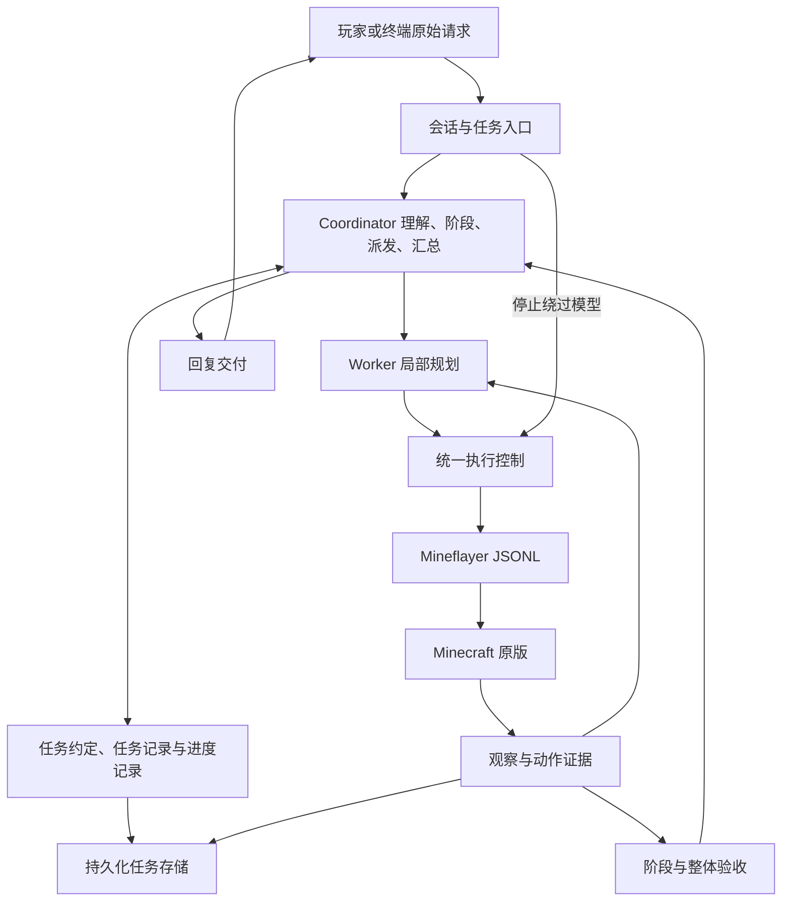

# 原版 Minecraft 两层 Agent 实现手册

> 当前实现修订：最高层使用自然语言完成标准，不再使用独立 LLM Reviewer。若本文与 [Coordinator 自主规划修订](COORDINATOR_AUTONOMY.md) 冲突，以修订为准。

文档版本：1.0 · 设计日期：2026-10-28

适用仓库：Super-Intelligent-Minecraft。审阅代码基线：`2b07d76216353e685af3a78c82ae6822253ebe23`。

**性质：待实施的目标设计，不是现有功能声明。** 用户已同意两层决策的架构方向，本次交付为实现手册，不表示代码已改造或新架构已通过测试。接手者须先核对当前代码，保留已有工作，再分阶段实施。

配套文件：

- [验收场景与发布标准](VANILLA_ACCEPTANCE.md)
- [交给其他 LLM 的实施提示词](LLM_HANDOFF.md)
- [项目协作约定](../../AGENTS.md)
- [现有架构](../ARCHITECTURE.md)、[现有协议](../PROTOCOL.md)、[现有验证边界](../VALIDATION.md)

## 1. 目标、范围与术语

把当前“单模型选择有限目标和下一步动作”的原型，升级为能理解中文需求、动态分解阶段、派发子 Agent、依据执行反馈重规划，并向玩家交付真实结果的原版 Bot。

### 1.1 本版必须交付

1. Coordinator 与 Worker 两种真实决策角色，各有独立上下文、提示词和调用记录。
2. 原始请求、任务约定、阶段计划与底层谓词分离；信息问答不再伪装成移动任务。
3. 统一动作控制、全局预算、取消、版本隔离和副作用记录。
4. 有依据的环境描述、状态问答和失败解释，以及现有原版动作的单任务、复合任务执行。
5. 阶段验收、整体验收、玩家回复交付形成闭环。
6. 持久化任务状态；重启后识别未结束任务，显式续接前核对现场。
7. 三人共同测试：所有获准玩家均可提交任务、停止、纠正和回答；一个共享任务，一次一个。
8. 面板展示真实任务树、两层模型输出、计划修订、执行证据和验收结果。

### 1.2 本版不做

- 自动课程、自主探索学习、经验检索增强、技能生成/晋升、模型训练。
- 整合包、模组机器、自定义服务端配方发现、通用 GUI、跨游戏后端。
- 完整从零生存、任意建筑、战斗、自动放置方块等未实现动作。
- 模型生成并执行任意 JS/Python、控制台命令、传送、刷物品、shell。
- 无限递归 Agent、多机器人协同、玩家任务队列、云平台依赖。
- 整体迁移到 AutoGen、LangGraph、Deep Agents；借鉴机制，不引入整套框架。

保留现有学习代码和历史数据。新路径限定 B0，不检索跨任务经验；hierarchical 路径遇到 B1 配置明确报不支持，不能静默改配置。当前任务的持久化、恢复和局部重规划不属于跨任务学习。

### 1.3 术语

| 名词 | 本手册含义 |
| --- | --- |
| Coordinator / 协调 Agent | 理解需求、分阶段、派发、重规划、汇总的上层模型角色 |
| Worker / 子 Agent | 在明确范围内完成一个阶段的下层模型角色 |
| Controller / 控制器 | 执行约束、预算、工具校验、轮询与取消的程序 |
| Verifier / 验收器 | 程序验证加按需语义审查；不拥有直接动作权限 |
| Contract / 任务约定 | 需求、限制、交付物和验收要求 |
| Fact / 事实 | 有来源、时间和世界范围的观察，或明确标注的用户陈述 |
| Evidence / 证据 | 后端查询、动作结果、差分、回复提交等程序记录 |
| Stage / 阶段 | 有输入、依赖、完成要求和预算的子任务，不等于一次动作 |

## 2. 现状与迁移映射

以下对应上述代码基线；实施前重新核对，不按行号盲改。

| 现有位置 | 现状 | 迁移方式 |
| --- | --- | --- |
| `execution/service.py` | 前缀、多人授权、忙状态、停止/纠正/回答；最终发 outcome.message | 保留入口，拆出会话和交付，保存完整聊天与正文 |
| `planning/planner.py` | 首轮必须选有限 goal，再逐步决定动作 | 新建两个角色协议，旧提示词不用作 Coordinator |
| `domain/task_spec.py` | intent 从 goal.type 派生 | 新 Contract 独立表达需求；旧 TaskSpec 仅兼容旧路径 |
| `execution/runner.py` | 规划、约束、执行、预算、验收集中 | 先抽执行服务，再建调度器；不复制两份巨型 Runner |
| `domain/goals.py` | 库存、容器、位置、跟随及组合谓词 | 保留，增加根/阶段基线作用域适配 |
| `domain/constraints.py` | no_move/no_collect/保留库存/来源约束 | 统一控制器强制执行，不只写在提示词里 |
| `domain/references.py` | 有限歧义检查 | 作为辅助，不当完整语义理解 |
| `adapters/mineflayer.py` | JSONL、响应关联、超时、生命周期 | 保留，两角色共用一个 Backend |
| `executor/lib/` | 原版动作、互斥、取消、部分效果 | 优先复用，只按明确协议增量扩展 |
| `planning/model.py`、`streaming.py` | 供应商适配、流式分离、取消 | 共用客户端，角色上下文独立 |
| `observability/`、`app/dashboard.*` | 调用归档和面板 | 增加角色/阶段/版本，兼容旧记录 |
| `memory/` | 轨迹、B1检索、技能接口 | 冻结学习扩展；当前任务存储独立于学习库 |

真实回归案例：“描述你所处的环境”被转换为 near_position；模型收到了中文正文，但被首轮 goal 规则诱导，以到达当前位置作为成功。最终描述没有作为正式交付送到玩家。解决的是语义替换和交付脱节这一类问题，不得只给该句加正则特判。

## 3. 架构、目录与依赖



依赖规则：domain 为纯数据/校验，不导入模型、游戏、数据库；agents 仅提议，没有 Backend 或状态写权限；orchestration 拥有状态转移权；execution 是唯一工具执行入口；verification 需要的新查询也经控制器；interaction 不绕过任务生命周期调用模型；app 组装具体实现；面板为只读投影。

```text
src/sim_agent/
  app/                       # 保留CLI/config/dashboard，组装新服务
  domain/
    contracts.py             # 请求、需求、交付物、约束
    plans.py                 # 阶段、依赖、计划修订
    evidence.py              # 证据、来源、时间、作用域
    lifecycle.py             # 状态转移
    proposals.py             # 两种模型提议结构及纯校验
    goals.py                 # 复用现有谓词
    constraints.py           # 复用现有约束
  agents/
    coordinator.py
    worker.py
    context.py               # 两层上下文和裁剪
    prompts/                 # 或等价的独立Python常量模块
  orchestration/
    task_runtime.py          # 主循环、事件分派、状态转移
    scheduler.py             # 依赖校验、就绪阶段、单Worker调度
    budget.py
    recovery.py
  interaction/
    session.py
    delivery.py
  execution/
    controller.py            # 唯一工具入口
    service.py               # 暂保留兼容门面
    runner.py                # 迁移期旧路径，不新增高层职责
  verification/
    contract_review.py
    stage.py
    task.py
    report.py
  capabilities/
    vanilla.py               # 参数、效果、前提、限制
  persistence/
    task_store.py            # 存储协议及SQLite实现
    migrations/
  adapters/                  # 保留Mineflayer/mock/Node定位
  planning/                  # 暂留model/streaming/rules/旧planner
  observability/
  evaluation/
  memory/                    # 本版冻结学习功能
executor/                    # Node执行器
```

职责清楚时可合并小文件，禁止为了凑目录建空框架。第一版不移动稳定的模型客户端，降低迁移风险。

## 4. 不可破坏的不变量

1. 原文不可被归一化目标覆盖；保存 raw_chat 和 command_text，模型始终获得正文与有效纠正。
2. 用户需求不限于当前 Goal 枚举；不能用相近动作代替不支持的需求。
3. 模型输出仅是提议，不能写事实、预算、verified 或直接执行世界变更。
4. 约束继承且只能加严，用户明确纠正才可放宽用户约束。
5. 计划修订不重置根预算、根基线和已发生副作用。
6. 状态谓词通过不等于原始请求已满足；验收覆盖全部必需交付。
7. 未观察、不支持、结果未知、观察到为空分别表示。
8. 同时仅一个占用身体/界面的操作；inspect_container 也占锁。
9. 停止不等待模型；旧动作真正收尾才释放互斥。
10. 晚到输出核对身份和版本；过期提议不执行，晚到真实效果仍归档。
11. 断流、截断或非法 JSON 不执行部分提议。
12. 结果不明的非幂等动作不盲重试；不宣称 exactly-once。
13. 游戏证据、模型推断、用户陈述、报告提交是不同类别。
14. 供应商实际思考输出只展示归档，不进入工具解析和完成判断。

## 5. 数据契约

采用 dataclass/Enum 或已有风格；不强制新依赖。外部输入严格检查类型、长度、有限数值、枚举、引用。建议未知可执行字段直接拒绝；schema版本不匹配明确报错。

### 5.1 身份与版本

| 字段 | 定义 |
| --- | --- |
| root_task_id | 程序生成，贯穿原请求、纠正、澄清、恢复 |
| task_id | 每个运行attempt的新ID，兼容旧日志一次运行一条episode |
| task_version | 需求语义版本，纠正递增；改变绑定/需求的澄清答案被采纳时递增 |
| contract_revision | 同一语义版本内约定修订，不能偷偷改变用户要求 |
| plan_revision | 拆分/策略版本，不重置需求与预算 |
| stage_id / attempt_id | 阶段与Worker尝试；重试新attempt，不复活旧尝试 |
| call_id / action_id / evidence_id | 模型调用、后端动作、证据 |
| executor_session_id | 后端进程会话；重启后旧action_id不能直接沿用 |

调度器创建 DecisionEnvelope：`root_task_id, task_id, task_version, contract_revision, plan_revision, stage_id?, attempt_id?, call_id`。这些可信身份不由模型生成。消费返回值时再次检查版本、状态和取消标记。

### 5.2 OriginalRequest

字段：`root_task_id, source(chat|cli), raw_chat, command_text, requester, received_at, amendments[]`。

amendment：`id, type(correction|clarification), author, text, question_id?, received_at, accepted_version?`。原文追加保存，不原地替换。去前缀后的正文与完整聊天都留存；模型输入正文及全部有效修订。密钥和HTTP头不进入记录。

### 5.3 TaskContract

```text
schema_version: "task-contract.v1"
root_task_id, task_version, contract_revision
intent_summary: 开放自然语言，不是goal.type
requirements: Requirement[]
constraints: 结构化约束及原文依据
deliverables: Deliverable[]
bindings: 对象/玩家/位置绑定和来源
unknowns: 待查询、待推导、待确认事项
status: draft | needs_clarification | accepted | superseded
```

Requirement：`id, text, source_refs[], required=true`。source_ref引用原请求/amendment的精确文本片段，程序验证确实存在；推导要求显式标记，不能把新增偏好当用户要求。

Deliverable：`id, description, requirement_ids[], acceptance_checks[], required=true`。description开放，允许报告、解释和世界结果组合。

AcceptanceCheck为discriminator结构：

| kind | payload | 通过条件 |
| --- | --- | --- |
| state_predicate | goal、baseline_ref?、scope(root/stage)、freshness_policy | 新观察与正确基线满足GoalVerifier |
| evidence_requirement | evidence_kind、selectors、requirement_ids | 有可验证查询/动作证据，不仅是非空字符串 |
| grounded_report | required_topics、permitted_evidence_kinds | 内容覆盖、真实引用、事实推测分离 |
| delivery_submission | channel(game_chat/cli)、report_id | 必需报告分段取得提交回执，不代表已读 |
| semantic_review | rubric、requirement_ids | 语义支持性检查，不能覆盖失败的状态检查 |

以上是验收机制，不是用户意图列表。无法验证的必要交付显式标为证据不足，不退回伪位置目标；不支持任意Python表达式作为验证器。

report_id在起草Contract时可以为空，先用deliverable_id声明报告要求；ReportDraft落库时由程序绑定，进入交付前必须解析为实际report_id。不能为了满足schema让模型编造一个尚不存在的报告或证据ID。

Contract接受流程：程序先检查来源、需求覆盖、约束、能力、绑定和检查器；涉及动作的Contract在首次世界变更前执行一次独立语义审查，输入原文和Contract，不输入起草模型的思考。可复用同模型，但上下文独立。审查返回 supported/mismatch/uncertain，并列冲突/遗漏；它不是数学证明。

mismatch退回修订，默认最多2次，不能重试到审查器点头；uncertain中可查的先查询，涉及用户偏好的关键歧义再问。报告任务可将对齐审查与最终报告审查合并。模型无法通过字段自行把Contract设为accepted。

### 5.4 Plan与Stage

Plan：`plan_revision, contract_ref, stages[], change_reason, based_on_evidence_ids[]`。

Stage：`id, title, objective, requirement_ids, dependencies[], input_evidence_ids[], allowed_capabilities[], expected_outputs, acceptance_checks[], budget, status, attempts[], result_ref?`。

第一版依赖图为DAG，仅运行一个Worker；DAG表示逻辑依赖，不是动作并发。默认一份计划最多12阶段；逐步细化可替换未开始阶段，累计尝试仍受根预算约束。必须检查依赖存在、无环、就绪阶段可达、需求覆盖；不能删除已执行记录。每阶段关联用户要求或明确的信息前提。

### 5.5 Evidence与Fact

Evidence：`id, root_task_id, task_id, stage_id?, world_id, executor_session_id, observed_at, received_at, kind, payload, origin(request_id/action_id), supersedes?`。

Fact：`id, statement/value, source_evidence_ids[], status(observed|user_asserted|inferred|unknown), valid_scope, freshness`。

ID由程序生成，模型仅引用可见ID；字段路径必须解析到真实值。引用证据不自动使整句话成立。用户“那里有箱子”是user_asserted，查询后才能observed。推断不覆盖观察；失效保留历史。UTC用于记录，活动超时用monotonic，恢复不用旧monotonic值。

当前 `domain/state.py` 对部分缺失数值有默认0的归一化。新证据层必须保留原始字段是否存在，不能把该兼容默认值升级为“健康确实为0”等事实；若修改公共归一化函数，同步回归旧路径。

bindings至少包含 `id, kind, value, source_refs, observed_evidence_ids, resolution_status`。用户明确给坐标可以建立意图绑定，但箱子是否存在仍需观察；“那个箱子”不能因最近箱子可达就自动绑定。模型可推导候选，不可将候选直接当确定事实执行。

### 5.6 Result与Outcome

Worker提交候选StageResult：`summary, output_refs, evidence_ids, unresolved_items, proposed_next_steps`。程序补充 `verification_results, actual_effects, status`。

根TaskOutcome：`root_task_id, task_id, task_version, end_state, work_status, delivery_status, completed_requirements, incomplete_requirements, report_ref, evidence_refs, usage, actual_effects, recovery_required`。

- work_status：verified/partial/unverified。
- delivery_status：not_required/pending/submitted/failed/unknown。
- completed仅在必需工作验证且必需回复提交成功后成立。
- 游戏目标达成但聊天失败：保留work_status=verified，进入interrupted或failed，恢复时只补交付，不再制作。
- 旧outcome.message保留作人类摘要，不能成为唯一交付内容。

## 6. 模型协议、接口与提示词

### 6.1 共用协议

每次返回一个完整JSON对象；reasoning与decision独立归档，只有正常完整结束的decision可解析。禁止eval、执行Markdown代码块或正则抢救截断动作。

所有提议使用 `schema_version, kind, summary, payload`；kind决定payload结构，未知kind和额外可执行字段拒绝。身份版本由程序envelope注入。非法输出提供结构化错误，最多2次修复调用，计入根预算，不静默回退rules。

### 6.2 CoordinatorProposal

| kind | payload | 行为 |
| --- | --- | --- |
| propose_contract | contract_draft | 形成或修订约定，不执行动作 |
| propose_plan | stages、change_reason、based_on_evidence_ids | 建立或修订阶段计划 |
| dispatch | stage_id | 请求调度就绪阶段，程序查依赖与预算 |
| request_information | question、requested_capabilities、evidence_refs | 建立受限观察子任务，draft阶段也可补信息 |
| clarify | question、missing_fields、alternatives? | 暂停等待玩家 |
| submit_report | report、requirement_ids、contract_draft? | 候选报告，进入验收与交付；首次直接回答需附最小约定草案 |
| request_completion | deliverable_refs、evidence_ids | 申请总验收，不直接completed |
| cannot_complete | reason_code、explanation、unmet_requirements | 明确能力不足或无法继续，保留进展 |

draft阶段的request_information仅用无需移动/打开界面的查询；要移动才能查时先建立符合原请求范围的执行约定。没有原请求授权的额外行为需要澄清。

上层首轮不必给底层goal，不必详细展开全部阶段，不必派发。已有事实足够时可submit_report；尚无Contract时该提议必须附最小报告contract_draft，走同样的来源/覆盖/语义检查，不能只引用不存在的requirement。审查和报告验证通过后短事务接受约定；不要在SQLite事务或会话锁内等待模型网络调用。Coordinator不能直接用act/say JSONL。

提示词核心：

```text
你负责完成玩家原始请求，不是选择容易通过的游戏谓词。
保留原文与有效纠正，区分交付要求、限制、事实、假设和未知。
根据情况回答、查询、澄清或分阶段；只细化当前需要的步骤。
计划是可修订的方法，不能通过改验收条件宣布原任务成功。
把局部动作交给Worker，保留全局范围、预算和完成要求。
只依证据评估进展；子任务结束不等于总任务结束。
不支持或无法确认时明确说明，不编造工具、事实、证据ID。
返回规定格式的一项提议，不自行写状态。
```

### 6.3 WorkerProposal

| kind | payload | 行为 |
| --- | --- | --- |
| query | op、args、purpose | 允许的observe/find_blocks/recipes/inspect_container子集 |
| act | kind、args、purpose | 原版动作，映射现有act请求 |
| submit_result | summary、output_refs、evidence_ids、unresolved_items | 申请阶段验收 |
| blocked | category、explanation、attempted_evidence_ids、needed_information | 向上层升级，不直接问玩家 |

Worker不替换总目标、不再派生Agent、不直接聊天、不扩大能力和预算。

```json
{
  "schema_version": "worker-proposal.v1",
  "kind": "act",
  "summary": "按已确认配方制作本阶段所需木板",
  "payload": {
    "kind": "craft",
    "args": {"item": "minecraft:oak_planks", "count": 8},
    "purpose": "完成阶段要求，执行后仍需核对实际产物"
  }
}
```

这是协议示例，不是固定测试解法。提示词要求：遵守原文和阶段范围，查询缺事实，每次提议一步，读反馈再调整，不重放未知结果动作，submit_result只请求验收。

### 6.4 推荐接口

以下为目标接口，名称可调整但责任不能混合；均接受依赖注入，便于脚本模型和mock测试。

```python
class Coordinator(Protocol):
    async def propose(self, context, timeout, observer) -> CoordinatorProposal: ...

class Worker(Protocol):
    async def propose(self, context, timeout, observer) -> WorkerProposal: ...

class ExecutionController(Protocol):
    async def execute(self, request, execution_scope) -> ExecutionResult: ...
    async def cancel_and_reconcile(self, execution_scope) -> Settlement: ...

class VerificationService(Protocol):
    async def verify_stage(self, stage, scope) -> VerificationReport: ...
    async def verify_task(self, contract, scope) -> VerificationReport: ...

class DeliveryService(Protocol):
    async def submit(self, verified_report, scope) -> DeliveryResult: ...

class TaskStore(Protocol):
    def commit_transition(self, expected_revision, events, snapshot) -> None: ...
    def read_task(self, root_task_id) -> TaskSnapshot: ...
```

execution_scope由程序创建，包含身份版本、继承约束、允许能力、预算、取消token和基线引用。verify所需查询经controller，不持有绕开约束的另一条Backend。commit_transition用版本比较防止过期写入；不能把async任务并发写同一状态当成安全。

### 6.5 上下文与裁剪

- Coordinator：原文和有效修订、Contract、任务/进度记录、世界摘要、阶段结果与证据索引、能力摘要、剩余预算、本次触发事件。
- Worker：原文和全局限制、阶段、相关bindings与证据、局部历史、最新观察、具体可用schema、根与局部预算。
- Reviewer：原文、Contract/报告、实际证据、rubric；不输入执行者思考和长篇自证。

超长时先移除无关大结果，再以证据引用摘要替代旧过程；原始需求、纠正、硬约束、未完成项、基线和未知效果不能丢。原始记录可按ID受控读取。仍超限则exhausted，不截掉约束继续。两角色默认共用现有model配置和客户端，独立上下文；不要求不同模型，也不为此新增进程。

## 7. 调度与状态机

### 7.1 根任务状态

正常流：`received → interpreting → planning → executing → verifying → delivering → completed`。

| 状态 | 特殊转移 |
| --- | --- |
| interpreting | 信息补查仍属此态；报告可直接verifying；澄清到waiting_input |
| planning | 约定不清返回interpreting；就绪阶段到executing |
| executing | 阶段结束/阻塞到planning；申请总验收到verifying |
| verifying | 证据不足回planning；需玩家信息到waiting_input；通过到delivering |
| delivering | 所有必需段提交才completed；不明到interrupted；确定失败到failed |
| waiting_input | 无模型循环；匹配回答到interpreting/planning |
| cancelling | 收尾到cancelled或superseded；无法确认收尾到interrupted |
| interrupted | 显式恢复核对后到interpreting/verifying/delivering；无法解决到waiting_input/failed |

所有非终态允许因stop进入cancelling，因断线进入interrupted，因已知不可恢复错误failed，因预算耗尽exhausted；若仍有在途动作，应先取消收尾再落入目标终态。`completed/failed/cancelled/exhausted/superseded`是终态，不复活旧attempt。

waiting_input为持久化暂停态，兼容旧显示needs_clarification。暂停不计活动时长、不返还已耗预算；仍占共享会话，普通新任务提示先回答/取消。重启不自动执行。failed/exhausted如需再做由新请求创建新root并明确关联历史，不通过恢复重置额度。

阶段状态：`pending → ready → running → verifying → succeeded`；可到blocked/failed/cancelled/interrupted。依赖只认程序验证的succeeded。blocked经上层调整建立新attempt，不复活取消的attempt。

### 7.2 驱动循环

```text
持久化原始请求，建立根预算与运行版本
初始observe进入Evidence，登记根库存基线
while 运行非终态:
    优先处理stop/correction/disconnect
    检查身份、预算和取消状态
    按状态构建Coordinator或Worker上下文
    调用模型，记录带版本envelope的输出
    丢弃非完整、过期、已取消的可执行提议
    调度器处理约定/计划/派发/工具/验收/澄清/交付
    关键状态转移及证据事务落库，更新只读投影
    普通动作反馈留Worker；阶段变化与阻塞交Coordinator
收尾：保存实际效果、未完成项、用量、交付状态
```

信息子任务也有阶段ID，但它的完成不代表根任务完成。无活动Worker时调度器能继续上层，不等待不存在的阶段。

### 7.3 重规划与停滞

上层触发：阶段结束、Worker blocked、局部失败阈值、关键假设被推翻、用户纠正/回答、整体验收遗漏、预算不足。

局部同类失败最多2次后上报；未知结果立即上报核对。重复指纹使用操作、规范化参数、错误类别和相关事实版本，不仅比较文本。正常长动作由程序轮询，不能因等待期间无模型输出算停滞。

有效进展：新事实、未知事项解决、阶段完成、验收差距缩小。改写计划/解释不自动算进展。默认连续2次上层决策无进展触发一次显式重规划；根任务最多3次停滞重规划，仍无进展则failed或waiting_input。不得通过换stage_id清零根计数。

修订列新增/删除/替换阶段及证据原因。不能重做已完成制作；改目标箱先核对成品、旧箱效果、新箱基线。保持未完成requirement覆盖。

## 8. 原版能力和执行协议

CapabilitySpec：`id, description, args_schema, side_effects, requires_body_lock, preconditions, evidence_produced, cancellation_limits, supported`。原版静态注册结合后端声明，不做插件市场。

| 能力 | 锁与语义 |
| --- | --- |
| observe | 只读角色快照，无身体锁 |
| find_blocks | 有界、已加载范围，只读；未找到不是全世界不存在 |
| recipes | 原版注册表，不冒充服务端任意配方 |
| inspect_container | 身体/窗口锁，可能移动；先验绑定与约束 |
| goto / follow | 身体锁；follow有限时长 |
| collect | 破坏方块、改变库存；count为方块数，产物另验 |
| craft | 消耗材料；count是最少新增产物，配方整批执行 |
| deposit / withdraw | 指定转移数量，双方差分证据 |
| smelt | 燃料材料变化，有界等待，检查实际取回产物 |
| say | 聊天副作用，仅DeliveryService调用 |
| stop / action_status | 控制与状态，不被普通动作锁堵住 |

Python和Node继续双侧校验。入队时检查，在真正提交前再检查版本、约束、预算和关键事实。能力声明是supported/unsupported/unknown，不把未知当自动可用。

### 8.1 环境描述

现有observe不提供全景地形、所有生物或可靠生物群系。最低要求：基于现有位置、维度、玩家、库存和find_blocks正确描述，说明范围，不编造森林/湖泊。

可选增强（仍在原版范围）：有界只读environment字段，包含附近非玩家实体、方块抽样、时间，以及后端确实支持的天气/群系。实现时每项携带status(known/unknown/unsupported)、radius、limit、truncated、observed_at。Node/Python都校验大小和类型，旧后端缺字段仍可描述已有事实。不做每tick全区扫描。若不做此增强，交付明确感知范围；它不是发布核心架构的必要前提。

### 8.2 协议兼容

本手册为内部提议协议v1，现有Python↔Node JSONL v0.2不因两层模型而全部重写。新增观察字段做兼容扩展。新增会话/协议协商在ready中声明；旧后端由适配器生成本地进程会话ID并标明来源。

action_id不是客户端幂等键。即使新增request_id也不能自动保证exactly-once；没有完整实现与验证前不要做该承诺。

## 9. 验收、基线与语言结果

### 9.1 完成规则

依次检查工具实际结果、阶段acceptance_checks、根任务required deliverables。根完成由程序计算：

```text
Contract已接受
AND 全部必需交付检查通过
AND 无未解决的约束违反/未知副作用
AND 当前版本有效且未取消
AND 必需报告全部提交
```

不能因为所有stage标成功就结束，计划可能遗漏用户需求。不能让模型的is_satisfied覆盖失败谓词。失败/无法完成的解释也应送达，但送达解释不把原任务变成completed。

### 9.2 基线与数量

Baseline：`id, root_task_id, scope, stage_id?, world_id, resource, evidence_id, captured_at, reason`。模型不能提交数量当初始基线。

- 根背包基线在首次observe建立；阶段基线在阶段动作前建立，分别引用。
- 已绑定来源/目标箱的基线在相关生产搬运开始前建立，避免动作后才捕获。
- 新attempt、重规划、纠正不覆盖旧根基线。
- 改目标箱为新箱建立基线，保留旧箱真实变化；不能自动搬回旧交付来掩盖副作用。
- 已发生动作但缺必要基线：insufficient_evidence，不倒推假初值。
- 复合容器验收后重新观察角色位置/库存，避免检查箱子期间移动导致位置验证失真。

craft整批产出可能多于要求；区分至少/精确交付，额外产物怎么处理应符合原文，不自动增加“所有剩余为0”的无依据条件。保留库存为下限，不等于精确零增量。

### 9.3 鲜度、干预和证据边界

完成判断使用本轮新observe及实际箱子检查；不要把“5秒内”当没有变化的保证。附近扫描阴性只说明范围内未发现。

多人世界箱子净增不必然由Bot造成。要求本次生产交付时，结合制作/转移动作链与状态差分；别人干预导致归因不清时核对并说明，不宣称已证明。测试采用隔离夹具。

可堆叠物品“保留原有3块”采用数量保留：动作前后和消耗预测不低于下限；不能宣称逐块物品身份不变。涉及严格NBT/身份且证据不支持时说明限制。

### 9.4 ReportDraft

字段：`id, text, claims[], covered_requirement_ids[], limitations[]`。claim：`text, kind(observed|inferred|limitation), evidence_refs[]`。

程序检查引用存在、世界/版本适用、明确数值名称匹配；语义审查检查漏答、夸大和事实支持。存在草方块证据不能自动支持“森林”判断。不能只检查evidence_id非空。

信息足够就答，范围不足明确“目前观察可确认……，尚未观察……”。若未满足必要要求，结果是partial/unverified，不能因写了免责声明记全面成功。审查结果是支持性证据，不是确定性真值。

## 10. 玩家交付与多人会话

### 10.1 DeliveryService

生成generated、后端提交submitted、玩家已读read分开，本项目只确认到submitted。流程：报告验收→存全文→切分→限流→逐段回执→更新状态。

- Node限制200 UTF-16 code units；建议每段含编号前缀不超过190。Python len与JS length不同，覆盖emoji，不切坏Unicode字符。
- 保持至少1.2秒间隔；进度可合并，最终报告/澄清不可静默丢弃。
- 默认最多8段，超长先压缩，或明确给摘要及本地面板全文；不得悄悄裁掉交付要求。
- `(report_id, part_index)`记录提交状态，明确已提交的不重发。
- say超时为unknown，可能服务器已收到；不保证端到端去重。显式补发要标明补发。
- 不发送斜杠命令/控制字符；每段提交前检查任务版本和取消。
- stop通知走独立控制消息，不依赖已取消的普通回复队列；仍遵守长度与限流。
- CLI与聊天共享报告对象，分别使用输出适配器。

### 10.2 三人输入约定

保留owner=`*`、前缀过滤、忽略自己聊天，记录每个操作人的身份。

| 输入 | 行为 |
| --- | --- |
| 空闲普通任务 | 建立新root |
| 忙碌普通任务 | 明确拒绝，不替换、不排队 |
| 停止 | 任一获准玩家可整树取消 |
| 纠正 ... | 取消收尾→保存效果→递增版本→新运行 |
| 回答 ... | 只消费当前唯一question_id，保留原请求，不把答案当新原文 |
| 继续 [task_id] | 拟新增，恢复匹配interrupted任务，先核对现场 |

并发回答/纠正用会话锁和版本比较；第一个有效答案消费问题，后到的提示已处理。冲突指令不让模型混合；记录后到有效纠正，关键歧义再澄清。

## 11. 取消、异常、持久化与恢复

### 11.1 取消顺序

1. 会话锁内禁止新派发，标cancelling并递增调度generation。
2. 取消两角色等待/普通报告队列，关闭观测回调，封存模型调用。
3. 立即backend.stop，不等模型结束。
4. 查询在途action_id和新观察，保留部分效果。
5. 等动作收尾再释放锁；不明则interrupted并禁止新动作。
6. 纠正的新运行在收尾明确后才使用角色。

generation用于使调度失效，不代替用户语义task_version。晚到合法JSON不能触发新act，晚到真实回执归旧动作证据。

### 11.2 异常策略

| 类别 | 处理 |
| --- | --- |
| invalid_proposal | 有界纠错，计调用预算 |
| precondition_failed | 根据新事实换方案/补任务 |
| constraint_violation | 拒绝执行，不自动放宽 |
| unsupported | 解释缺能力，不以follow代attack |
| execution_failed | 保留已知副作用后调整 |
| outcome_unknown | 先核对，不自动重放 |
| world_changed | 相关事实失效，恢复核对或结束 |
| budget_exhausted | 停派发、收尾、报告部分结果 |

禁止吞异常后返回成功。保留错误类型与安全摘要，不写密钥/完整HTTP错误体。

### 11.3 TaskStore

使用本地SQLite `tasks.sqlite3`，与学习库分开。串行事务或单写入者；关键状态和事件同一事务提交。建议表：

`root_tasks, task_runs, requests, contracts, plans, stages, stage_attempts, evidence, baselines, action_journal, reports, delivery_parts, task_events, schema_migrations`。

模型长文本保留现有model-calls文件，库中存引用；归档与DB不能原子提交时标缺失，不阻塞安全停止。迁移只增量，保留旧数据库，不删表重建冒充升级。

action_journal在提交前写intent及规范化参数，再标submitting；收到action_id为acknowledged，最后terminal/unknown。提交与回执之间崩溃时submitting也可能已产生效果。

启动扫描活动状态标interrupted，waiting_input仍保留等待状态；不自动重放。显式继续需同世界、核对会话、重新observe和相关箱子。旧action_id在新后端会话不能当同一动作。

能证明完成的阶段保留；能证明未做的才继续；非幂等结果无法确定到waiting_input，说明具体不确定项。已生成报告若证据已过期，补发前按内容需求复核或标明历史时间。

预算已耗值持久化，中断时间不计活动时长，恢复只给剩余额度。取消任务不能用继续复活。

## 12. 预算、配置与兼容

### 12.1 计数

根预算至少有活动时长、模型调用、工具提交、已知token usage、局部失败、重规划。

- 模型计数包含两个角色、Reviewer、schema修复、网络重试，失败也计。
- 工具计数包含查询和act；程序action_status轮询不计模型步骤，但有频率/deadline上限。
- stop及必要核对有独立有界收尾时间，建议10秒；不是额外工作预算，超时保留未知。
- 子预算只是根预算内的上限，新Worker不重置根预算。
- 缺usage标incomplete，不能当0；token预算启用时结合输入估算和max输出预留，说明估算边界。
- 成本仅在有明确本地价格配置时标estimated，不硬编码供应商实时价格。

正常调度应为必要的最终观察、容器检查和报告提交预留工具次数与时间，而不是把所有预算用于生产动作。预留仍属于原根预算；不够时提前返回部分结果，不能在耗尽后暗加额度。没有剩余模型预算时用程序根据已记录字段生成简短结束说明，不能免费再调用模型。控制通知和取消收尾单独记录，不作为新的任务工作。

### 12.2 配置目标示例（尚未实现）

保留model/minecraft/node_executable/runtime_dir，新增：

```json
{
  "orchestration": {
    "mode": "hierarchical",
    "max_model_calls": 40,
    "max_plan_stages": 12,
    "max_replans": 3,
    "max_local_failures": 2,
    "max_schema_repairs": 2,
    "max_contract_repairs": 2,
    "recovery": "explicit"
  }
}
```

根工具提交预算沿用agent.max_steps，活动时长沿用agent.task_timeout_seconds，并说明新旧计数语义差异。模型单次timeout取配置与剩余时间较小值。40是最大调用数，不保证时间足够40次。

迁移期默认legacy，显式hierarchical验收；全部通过后新安装示例默认hierarchical。私人配置不批量覆盖，提供迁移说明。新模式B1明确报不支持。

保留显式`--planner rules`旧基线；llm由orchestration.mode选择。hierarchical首版明确拒绝`--goal-json`，不能让它覆盖自然语言，提示使用legacy工程测试。未来如支持要先对齐原文。

## 13. 日志与面板

事件公共字段：`schema_version, event_id, sequence, timestamp, root_task_id, task_id, task_version, plan_revision?, stage_id?, attempt_id?, call_id?, type, payload`。sequence确定持久化顺序。

模型调用元数据额外包含 `role(coordinator|worker|reviewer|legacy), purpose, provider, model, usage_status`。事件与model-calls使用同一call_id；角色不能由界面猜测或按调用次数交替标注。

事件类型至少覆盖request_received、contract_proposed/accepted/rejected、plan_created/revised、stage_started、model_started/ended、tool_proposed/rejected/submitted、action_settled、evidence_recorded、stage_verified、task_verification、clarification_requested/answered、cancellation_requested/settled、recovery_required、report_created、delivery_submitted/failed、task_finished。

面板必须显示：原文/玩家/纠正；需求与交付清单；真实阶段依赖和状态；角色及调用选择；真实reasoning与decision；工具提议与实际动作；证据与验收；预算与恢复；完整报告及分段提交。

模型流片段仍独立归档，不挤占普通时间线。旧记录显示legacy，不编造子Agent。只读本机GET，分页/文件大小限制保留；不新增任意路径读取或执行入口。玩家名、报告、模型输出以textContent等方式转义，防止面板脚本注入。

## 14. 分阶段实施

| 阶段 | 必做工作 | 完成条件 |
| --- | --- | --- |
| P0 基线 | 读AGENTS/当前diff；运行原测试与demo；建PROGRESS.md；复现信息任务和回复丢失 | 当前失败路径和真实基线可追溯，未改私有配置 |
| P1 契约 | 身份、Contract、Plan、Evidence、状态机、基线引用、纯校验 | 非法转移/需求遗漏/循环依赖/错基线测试通过 |
| P2 控制器 | 从Runner抽查询、动作、约束、轮询、取消收尾；旧路径共用 | 原动作/取消/互斥回归通过，没有复制执行逻辑 |
| P3 两层闭环 | 两角色、调度、阶段与总验收、报告和DeliveryService | 真实独立上下文；信息任务无伪目标；报告送达适配器 |
| P4 重规划与交互 | 语义审查、停滞检测、多人回答纠正停止、根预算 | 制作后改箱不重做；迟到输出无动作；并发答案隔离 |
| P5 持久化 | SQLite、动作日志、显式继续、未知效果核对 | 故障注入下无盲重放、无预算清零、无假恢复 |
| P6 面板与感知 | 真任务树、证据、交付状态、旧记录兼容；可选environment | 可从阶段追到实际调用/动作；感知缺失不编造 |
| P7 真实验收 | 隔离服、真实双供应商、长程与故障、冻结版本报告 | 满足验收手册后切新安装默认，更新当前文档 |

P0建立的`docs/implementation/PROGRESS.md`由实施者写，不在本手册交付时预先勾选。每阶段记录实际变更、测试命令/结果、未解决问题、下一步和设计偏差。

优先在P3形成从自然语言到玩家结果的完整纵向链路，不把全部基础框架做完后才第一次接游戏。P5跨进程恢复在动作/会话稳定后实现；不能仅序列化内存就声称完成恢复。

代码迁移完成后更新ARCHITECTURE/PROTOCOL/DASHBOARD/MODELS/DEVELOPMENT/VALIDATION/README；历史验收结果不能改写成新版本证据。若某项未做，继续标未实现，不因目录存在就宣称完成。

## 15. 验证与环境约束

当前已有命令（PowerShell、仓库根目录）：

```powershell
.\.venv\Scripts\python.exe scripts/dev.py check
.\.venv\Scripts\python.exe scripts/dev.py test
.\.venv\Scripts\python.exe scripts/dev.py demo
.\.venv\Scripts\python.exe scripts/dev.py run --config config.json --dashboard
```

dev.py test实际执行unittest discover和Node --test；新增用例沿用能被该入口发现的风格。不要仅写pytest fixture却未进入正式测试。

现有真实脚本live_acceptance.py和cloud_acceptance.py需要扩展才覆盖新架构。运行前读服务器启动、端口、fixture和清理逻辑。只能操作自己创建的隔离服/存档，不能重置、关闭用户正在玩的服务器。端口占用时停止启动并换隔离端口，不杀未知进程。

私有config/密钥/世界/预算不批量改。测试配置放runtime，引用本地密钥文件，不复制密钥到公开日志。行为更改按AGENTS运行test，跨层加demo；真实API、规则基线、mock分开报告。无密钥时明确云验收未完成。

## 16. 参考与取舍

- [Magentic-One](https://www.microsoft.com/en-us/research/articles/magentic-one-a-generalist-multi-agent-system-for-solving-complex-tasks/)及其[调度代码](https://github.com/microsoft/autogen/blob/main/python/packages/autogen-agentchat/src/autogen_agentchat/teams/_group_chat/_magentic_one/_magentic_one_orchestrator.py)：任务/进度记录与停滞重规划；我们不用模型is_request_satisfied替代游戏验收。
- [ReAct](https://react-lm.github.io/)：Worker分析、行动、观察交替；不强制长篇思考。
- [Deep Agents](https://docs.langchain.com/oss/python/deepagents/subagents)：上下文隔离，结果返回上层；本项目还要保留可追溯证据。
- [Anthropic长程实践](https://www.anthropic.com/research/effective-harnesses-for-long-running-agents)：进度持久化与端到端验证；游戏世界不能像代码一样随意回滚。
- [LangGraph持久化](https://docs.langchain.com/oss/python/langgraph/persistence)：任务检查点与跨任务记忆分离；检查点不保证外部动作幂等。
- [SayCan](https://say-can.github.io/)：任务相关性与当前可执行性分离；本版不用训练价值函数。
- [Voyager](https://voyager.minedojo.org/)：仅参考环境反馈；自动课程、技能增长、代码生成延期。

这些是设计依据，不是运行依赖，也不证明本项目新架构已有效。

## 17. 最终交付

代码、配置示例、实际实施进度；真实两层调用与交付演示；离线/原版/云测试分别记录；断线/取消/纠正证据；修正后单Agent与两层同预算对比；清楚写明尚未实现的能力。不声称自学习、整合包兼容或通用生存已经完成。

详细测试矩阵及发布门槛见[验收手册](VANILLA_ACCEPTANCE.md)。
